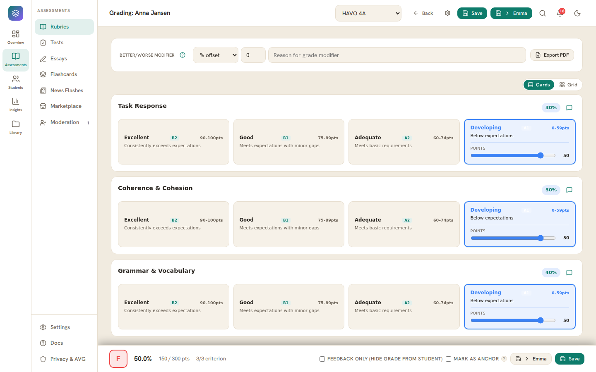
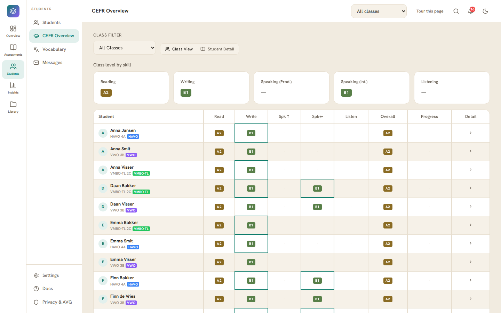
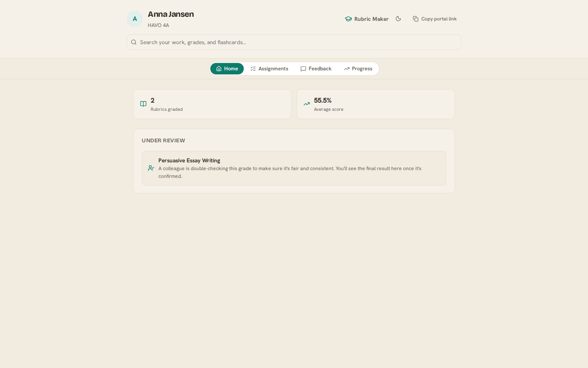
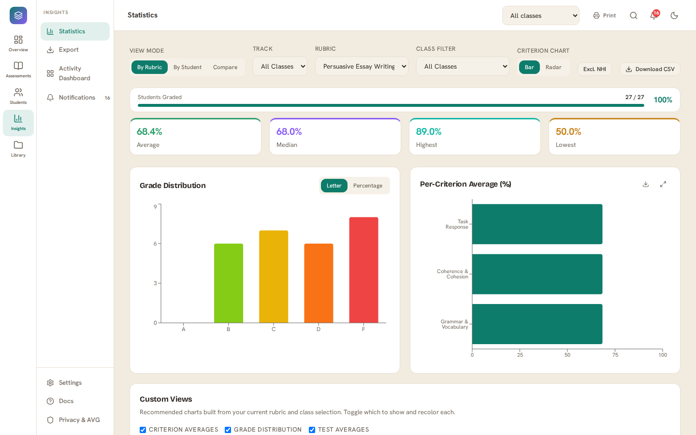

# Rubric Maker

[](https://github.com/NesiciCoding/RubricMaker/actions/workflows/ci.yml)
[](https://github.com/NesiciCoding/RubricMaker/actions/workflows/codeql.yml)
[](https://github.com/NesiciCoding/RubricMaker/actions/workflows/lighthouse.yml)
[](https://github.com/NesiciCoding/RubricMaker/actions/workflows/ci.yml)
[](LICENSE)
[](https://nesicicoding.github.io/RubricMaker/)

[](https://react.dev)
[](https://www.typescriptlang.org)
[](https://vite.dev)
[](https://supabase.com)
[](https://github.com/NesiciCoding/RubricMaker/wiki/Getting-started)
[](https://github.com/NesiciCoding/RubricMaker/wiki/Features)
[](#features)
[](#features)

<p align="center">
  
</p>

A comprehensive rubric creation and grading tool built with React and TypeScript — self-hostable with full functionality, and offline-capable (with reduced capabilities) when no backend is configured. Designed for educators who need to design complex rubrics, grade students efficiently, and analyse performance — including language proficiency tracking aligned to the Common European Framework of Reference (CEFR).

**No AI grading or content generation:** every score, suggestion, CEFR estimate and analysis in the app is deterministic and rule-based — nothing a student or teacher enters is ever sent to an LLM. (The codebase itself was built with AI coding assistance, same as a growing share of software; that's a build-tooling choice and separate from what the shipped app does with user data.)

> 🚀 **Try it now** — the [live demo](https://nesicicoding.github.io/RubricMaker/) runs entirely in your browser. No account, no install, no backend.

---

## Contents

- [Quick start](#quick-start)
- [How to read this README](#how-to-read-this-readme)
- [Features](#features)
- [Screenshots](#screenshots)
- [Documentation](#documentation)
- [Development 🧑‍💻](#development)
- [Tech stack 🧑‍💻](#tech-stack)
- [Deployment](#deployment)
- [Developer reference 🧑‍💻](#developer-reference)
- [Contributing & security 🧑‍💻](#contributing--security)

---

## Quick start

Pick the path that fits:

| You want to…                                    | Do this                                                                                        |
| ----------------------------------------------- | ---------------------------------------------------------------------------------------------- |
| **Try it immediately**                          | Open the [live demo](https://nesicicoding.github.io/RubricMaker/) — data stays in your browser |
| **Run it locally** (no backend)                 | The three commands below; everything works in `localStorage`                                   |
| **Run the full stack** (Docker + Supabase sync) | [Jump to the Docker quick start](#option-a-docker-full-stack)                                  |

**Run locally (3 commands):**

```bash
git clone https://github.com/NesiciCoding/RubricMaker.git
cd RubricMaker
npm install
npm run dev
```

Open [http://localhost:5173](http://localhost:5173). No backend or account is required — without one, all data lives in the browser's local storage.

---

## How to read this README

This document is the landing page, not the manual. Everything below is organised by audience — start where you belong and follow the links for depth.

| Reader                                               | Start with                                                                                                                                      |
| ---------------------------------------------------- | ----------------------------------------------------------------------------------------------------------------------------------------------- |
| **Teachers & educators** — you want to use the app   | [Features](#features), then the [user documentation wiki](https://github.com/NesiciCoding/RubricMaker/wiki)                                     |
| **Students** — you use the student portal            | [Student Portal wiki page](https://github.com/NesiciCoding/RubricMaker/wiki/Student-Portal)                                                     |
| **School IT / admins** — you deploy and operate it   | [Deployment](#deployment) → [Installation wiki](https://github.com/NesiciCoding/RubricMaker/wiki/Installation)                                  |
| **Developers** — you build or contribute to the code | [Development](#development) → [Tech stack](#tech-stack) → [Developer reference](#developer-reference) → [Contributing](#contributing--security) |

Sections marked 🧑‍💻 in the contents are written for developers — if you're here to _use_ Rubric Maker, you can skip them entirely.

---

## Features

One-glance overview — see the [Features wiki page](https://github.com/NesiciCoding/RubricMaker/wiki/Features) for the full, illustrated detail:

| Area                       | What you can do                                                                                                                                                                                               |
| -------------------------- | ------------------------------------------------------------------------------------------------------------------------------------------------------------------------------------------------------------- |
| Classes & cohorts          | Multi-year/track classes, cohort filters, per-student year/track tagging that drives CEFR targets.                                                                                                            |
| Teaching vs admin scope    | Admins who teach see their own/co-taught classes; a switch shows the whole school.                                                                                                                            |
| Rubric builder             | Criteria + levels, 3 scoring modes, tiered rubrics, standards/CEFR/Bloom's linking, versioning.                                                                                                               |
| Folders                    | Nested folders (4 levels) across rubrics, tests, essays and flashcards.                                                                                                                                       |
| Archive & class links      | Link material to classes; per-class test assignment (assign/unassign from the card menu, assign dialog or activity dashboard, without dropping existing results); archive without losing any grade or result. |
| Tests & quizzes            | 19 question types, cloze generators, exam-scan OCR, Safe Exam Browser, per-student accommodations.                                                                                                            |
| Rubric quality analysis    | Per-criterion P-value, Rit/Rir, Cronbach's α, SEM.                                                                                                                                                            |
| Score sheet & test quality | Spreadsheet grading, grading norms (N-term, caesura, grade tables), item analysis.                                                                                                                            |
| Practice & placement       | Practice mode plus 3 adaptive placement engines producing a provisional CEFR estimate.                                                                                                                        |
| Grading                    | Click/slider scoring, comment bank, voice feedback, handwriting-scan OCR, co-grading, peer review.                                                                                                            |
| Essays                     | TipTap editor, submission codes, live monitoring, deterministic (no-AI) writing stats.                                                                                                                        |
| Flashcards                 | FSRS spaced repetition, vocab/grammar decks, CSV/XLSX/DOCX import, student-created decks.                                                                                                                     |
| CEFR & language assessment | Proficiency overviews, speaking sessions, rule-based learning paths, grammar mastery.                                                                                                                         |
| Vocabulary profiling       | Rule-based (no-AI) CEFR vocabulary profiler with a target-level "is this text right?" verdict.                                                                                                                |
| Live writing               | In-class writing sessions, zero AI, anonymous finals gallery, peer voting, shareable tagged prompts, optional signed-in portal join.                                                                          |
| Student portal             | Shareable link per student: grades, to-dos, essays, tests, flashcards, messaging, 5 languages.                                                                                                                |
| Analytics                  | Student Snapshot dashboard, grade distributions, query builder, writing trends.                                                                                                                               |
| Export                     | PDF/DOCX/CSV, Magister/SOMtoday presets, CITO-style printable exam export.                                                                                                                                    |
| Collaboration              | Marketplace (including tagged live-writing prompts), live sharing, co-teaching, proctoring, notifications.                                                                                                    |
| Accessibility              | WCAG 2.1 AA + AAA contrast, dyslexia mode, six themes, global search.                                                                                                                                         |

**Offline-first, cloud-ready:** the core grading workflow works fully offline in `localStorage`. An optional [Supabase](https://supabase.com) backend unlocks cross-device sync, collaboration, the student portal and the marketplace — if it's configured but unreachable, the app falls back to local storage rather than failing. See [Supabase Sync on the wiki](https://github.com/NesiciCoding/RubricMaker/wiki/Supabase-Sync).

Live writing is the one feature that is **off in local mode**: a code-join room needs the shared backend, so `/live` and `/join` show a short "cloud connection required" empty state instead of pretending to run locally. There is no separate school-level switch; sessions are always teacher-created, and `Lock after start` stops late code joins once a round is running. A session can also opt in to **portal join**, which lets a signed-in student enter the code in their portal and join as themselves without the name picker.

---

## Screenshots

<table>
  <tr>
    <td width="50%"></td>
    <td width="50%"></td>
  </tr>
  <tr>
    <td><em>Interactive grading — click levels, slider scoring, comment bank, keyboard shortcuts</em></td>
    <td><em>Per-student and whole-class CEFR overview, benchmarked by track and year</em></td>
  </tr>
  <tr>
    <td width="50%"></td>
    <td width="50%"></td>
  </tr>
  <tr>
    <td><em>The student portal — grades, to-dos, essays, flashcards, and messaging</em></td>
    <td><em>Statistics dashboard with grade distributions, per-criterion breakdowns, and multi-class comparison</em></td>
  </tr>
</table>

More illustrated walkthroughs — including manual captures of live-service features — are on the [wiki](https://github.com/NesiciCoding/RubricMaker/wiki).

---

## Documentation

**User documentation (wiki):** [Home](https://github.com/NesiciCoding/RubricMaker/wiki) · [Getting started](https://github.com/NesiciCoding/RubricMaker/wiki/Getting-started) · [Features](https://github.com/NesiciCoding/RubricMaker/wiki/Features) · [Tests & Practice](https://github.com/NesiciCoding/RubricMaker/wiki/Tests-and-Practice) · [Flashcards](https://github.com/NesiciCoding/RubricMaker/wiki/Flashcards) · [Student Portal](https://github.com/NesiciCoding/RubricMaker/wiki/Student-Portal) · [Supabase Sync](https://github.com/NesiciCoding/RubricMaker/wiki/Supabase-Sync) · [FAQ](https://github.com/NesiciCoding/RubricMaker/wiki/FAQ)

**Deployment & operations (repo `docs/`):**

- [HestiaCP setup](docs/HESTIACP_SETUP.md) — shared hosting / cPanel-style VPS
- [Virtualmin setup](docs/VIRTUALMIN_SETUP.md) — Virtualmin VPS deployment
- [Observability on a HestiaCP subdomain](docs/OBSERVABILITY_HESTIACP.md) — Loki/Alloy/Grafana behind a dedicated HTTPS subdomain
- [Grafana dashboards](docs/OBSERVABILITY_DASHBOARDS.md) — what the provisioned dashboards show and how to customize them
- [Magister integration](docs/MAGISTER_INTEGRATION.md) — importing students from Magister SIS
- [Self-hosting operations](docs/SELF_HOSTING_OPS.md) — backup/restore, upgrades, resource sizing, pg_cron setup, troubleshooting
- [Branch protection & production environment](docs/BRANCH_PROTECTION.md) — recommended required CI checks for `main` and required reviewers for production deploys

---

## Development

To run the project locally:

1. **Install dependencies:**

    ```bash
    npm install
    ```

2. **Start the development server:**

    ```bash
    npm run dev
    ```

3. Open [http://localhost:5173](http://localhost:5173) in your browser.

**Other useful commands:**

```bash
npm run check        # Full pre-push gate: typecheck + lint + format + unit tests
npm run typecheck    # TypeScript check (run before commits)
npm run lint         # ESLint
npm run test         # Vitest unit tests
npm run coverage     # Coverage report
npm run e2e          # Playwright end-to-end tests (starts its own dev server, see below)

# Supabase local dev (optional)
npm run db:start     # Start local Supabase stack
npm run db:reset     # Reset and re-apply all migrations

# Backend load testing (k6) against a local Supabase stack (needs `npm run db:start`).
# Reads Supabase keys automatically; profiles: smoke | load | stress | spike | soak.
npm run loadtest              # default 'load' profile (~50 VUs)
npm run loadtest:stress       # climb VUs to find the breaking point
```

### End-to-end tests and their dev server

Playwright starts and stops its own dev server, on a port derived from the checkout path: 5173 for
the first checkout, a stable neighbour for any extra worktree, so two suites can run side by side
without sharing a server. It never attaches to a server it did not start unless you ask it to.

| Variable           | Effect                                                                                    |
| ------------------ | ----------------------------------------------------------------------------------------- |
| `E2E_PORT`         | Use this port instead of the derived one                                                  |
| `E2E_BASE_URL`     | Test an already-running origin (a preview deployment, a remote stack) and start no server |
| `E2E_REUSE_SERVER` | `1` attaches to a server already on the port — only if it serves _this_ checkout          |

Every dev server advertises the checkout it serves in an `x-rm-checkout` header, and the suite
refuses to run when the stamp doesn't match. That is deliberate: a fixed port meant a second
worktree's dev server could answer instead, and the whole run then passed against different code.

New to the codebase? See the [Development Guide](https://github.com/NesiciCoding/RubricMaker/wiki/Development-Guide) and [Architecture](https://github.com/NesiciCoding/RubricMaker/wiki/Architecture) wiki pages.

---

## Tech stack

| Layer              | Choice                                                                  |
| ------------------ | ----------------------------------------------------------------------- |
| UI                 | React 19 + TypeScript, built with Vite 8                                |
| Styling            | Plain CSS + Radix UI primitives                                         |
| Rich-text editing  | TipTap (ProseMirror)                                                    |
| Backend & sync     | Supabase (optional — Postgres, auth, storage, realtime, edge functions) |
| Spaced repetition  | `ts-fsrs` (FSRS algorithm)                                              |
| Unit testing       | Vitest                                                                  |
| End-to-end testing | Playwright                                                              |
| CI / CD            | GitHub Actions (CI, CodeQL, Lighthouse, e2e, deployments)               |

---

## Deployment

RubricMaker works in two modes:

- **Offline-only** — data lives in the browser's local storage. No server needed. Works on GitHub Pages, SharePoint, or any static host.
- **With database sync** — add an optional Supabase backend for multi-device sync, email login, and rubric sharing between teachers. Hosted on your own infrastructure.

> Deploying for a school? Read the [Installation wiki page](https://github.com/NesiciCoding/RubricMaker/wiki/Installation) first — it walks through the choices end to end.

### Option A: Docker (full stack)

The easiest way to run the full stack. Requires [Docker](https://docs.docker.com/get-docker/).

**Your own laptop or school LAN:**

```bash
./scripts/generate-docker-secrets.sh   # creates .env with random secrets (needs openssl)
docker-compose up -d --build
```

Open [http://localhost:8080](http://localhost:8080). To expose it on the network, set `SITE_URL=http://<your-ip>:8080` in `.env` first. The compose file refuses to start without secrets set — rerunning the script on an existing `.env` only fills in missing values. See [docs/SELF_HOSTING_OPS.md](docs/SELF_HOSTING_OPS.md) for upgrading an older installation or rotating secrets.

**VPS with a domain name (HTTPS):**

```bash
./scripts/generate-docker-secrets.sh   # random JWT_SECRET, POSTGRES_PASSWORD and API keys
# Edit .env:
#   DOMAIN=rubricmaker.school.nl
#   SITE_URL=https://rubricmaker.school.nl
docker-compose --profile https up -d --build
```

Caddy obtains a free Let's Encrypt certificate automatically. Open ports 80 and 443 on your firewall.

**Enabling email login (OTP):** without SMTP, teachers log in anonymously. Set `SMTP_HOST`/`SMTP_USER`/`SMTP_PASS` and `MAILER_AUTOCONFIRM=false` in `.env`, then `docker-compose up -d --force-recreate auth` — teachers get an 8-digit sign-in code by email (code-only, no clickable link, to avoid scanners consuming the token). Send through an SMTP relay rather than the school's own mail server — STRATO's `smtp.strato.de` when the domain is in a STRATO package, or Brevo (France) as an EU fallback — with SPF, DKIM and DMARC on the sending domain; school filters drop unsigned mail. See [docs/SELF_HOSTING_OPS.md](docs/SELF_HOSTING_OPS.md) → Email for the relay setup and the official-Supabase-stack override.

**Student login without email:** a teacher can set a student password directly (Students page → key icon) as a fallback when school spam filters block the OTP email. Needs a functions runtime in front of an API gateway — only available on the [official self-hosted Supabase Docker stack](https://supabase.com/docs/guides/self-hosting/docker) or Supabase Cloud, not this repo's own `docker-compose.yml`. Details: [docs/SELF_HOSTING_OPS.md](docs/SELF_HOSTING_OPS.md).

**Backup and restore:**

```bash
./scripts/backup.sh              # saves to ./backups/YYYYMMDD_HHMMSS/
./scripts/restore.sh backups/20260515_120000
```

See [docs/SELF_HOSTING_OPS.md](docs/SELF_HOSTING_OPS.md#backup-and-restore) for off-site backups/restore drills ([§off-site](docs/SELF_HOSTING_OPS.md#off-site-backups)) and migrating from Supabase Cloud ([§migrating](docs/SELF_HOSTING_OPS.md#migrating-from-supabase-cloud)).

**Updating to a new version:**

```bash
git pull
docker-compose up -d --build    # rebuilds the app image, restarts services; migrations run automatically
```

### Option B: Static hosting (offline mode only)

No database sync — all data stays in the browser. Works on any static host.

```bash
npm run build   # output in dist/
```

Deploy `dist/` to GitHub Pages, Vercel, Netlify, or any web server.

**SharePoint:** build, rename `dist/index.html` → `index.aspx`, upload the `dist/` folder to a Document Library, open `index.aspx`. For Standards Integration, add the SharePoint domain to your Common Standards Project API key's allowed origins.

### Operational guides

Deep operational detail — attachment retention, nightly backups, email digests, observability, load testing — lives in [docs/SELF_HOSTING_OPS.md](docs/SELF_HOSTING_OPS.md) and the linked docs below. Recommended for a production deployment:

- **Attachment cleanup** — nightly script purges attachments/scans past the retention period. [docs/SELF_HOSTING_OPS.md](docs/SELF_HOSTING_OPS.md)
- **Self-hosted Supabase stack** — the pinned official compose file, the production override and the env template live in [deploy/supabase/](deploy/supabase/README.md), so a host can be rebuilt from the repo, a `.env` and a backup.
- **Cloud backups** — nightly DB + Storage backup, on-site or (recommended) off-site. [docs/SELF_HOSTING_OPS.md](docs/SELF_HOSTING_OPS.md)
- **Error reporting** — JS-error-only telemetry, no user content, 30-day retention. [docs/ERROR_REPORTING.md](docs/ERROR_REPORTING.md)
- **Observability** — Loki/Prometheus/Grafana stack with alerting and a School Highlights wall-display dashboard (anonymous CEFR, grammar and activity totals; teachers can opt out in Settings). [docs/OBSERVABILITY_DASHBOARDS.md](docs/OBSERVABILITY_DASHBOARDS.md) · [docs/OBSERVABILITY_HESTIACP.md](docs/OBSERVABILITY_HESTIACP.md)
- **Load testing** — k6 harness to find a deployment's concurrency ceiling. [docs/LOAD_TESTING_STAGING.md](docs/LOAD_TESTING_STAGING.md)
- **Teacher email digest / stress-test logging** — optional, see [docs/SELF_HOSTING_OPS.md](docs/SELF_HOSTING_OPS.md)

---

## Developer reference

> 🧑‍💻 This section is for contributors — teachers and admins can stop here.

### Routes

A map of what each path renders — for how a page actually behaves, read its component. System-level design is on the [Architecture wiki page](https://github.com/NesiciCoding/RubricMaker/wiki/Architecture).

| Path                                               | Page                                                                 |
| -------------------------------------------------- | -------------------------------------------------------------------- |
| `/`                                                | Dashboard                                                            |
| `/rubrics`                                         | Rubric list                                                          |
| `/rubrics/new`                                     | New rubric                                                           |
| `/rubrics/import/:code`                            | Import a shared rubric                                               |
| `/rubrics/:id`                                     | Rubric builder                                                       |
| `/rubrics/:rubricId/grade`                         | Grading queue for a rubric                                           |
| `/rubrics/:rubricId/grade/:studentId`              | Grade a student                                                      |
| `/rubrics/:rubricId/peer-review`                   | Peer review roster                                                   |
| `/rubrics/:rubricId/peer-review/:studentId`        | Peer review view                                                     |
| `/peer-analytics/:rubricId`                        | Peer review analytics                                                |
| `/rubrics/:rubricId/self-assess/:studentId`        | Student self-assessment                                              |
| `/essays`                                          | Essay list                                                           |
| `/essays/new`                                      | New essay                                                            |
| `/essays/:teacherKey`                              | Essay builder                                                        |
| `/essays/:assignmentId/monitor`                    | Live essay monitor                                                   |
| `/essays/:assignmentId/monitor/project/:studentId` | Read-only draft projector                                            |
| `/live`                                            | Live writing session list                                            |
| `/live/new`                                        | New live writing session                                             |
| `/live/:sessionId`                                 | Live writing console                                                 |
| `/live/:sessionId/project`                         | Classroom projector                                                  |
| `/join`                                            | Public code entry for a live writing session                         |
| `/join/:code`                                      | Public student writing screen                                        |
| `/speaking/:rubricId/:studentId`                   | Speaking session                                                     |
| `/grade-comparative/:classId/:rubricId`            | Comparative grading                                                  |
| `/marketplace`                                     | School marketplace (rubrics, tests, decks, bank items, live prompts) |
| `/tests`                                           | Test list                                                            |
| `/tests/new`                                       | New test                                                             |
| `/tests/:id`                                       | Test builder                                                         |
| `/tests/:testId/results/:studentTestId`            | Test results & manual grading                                        |
| `/tests/:testId/monitor`                           | Live test monitor                                                    |
| `/tests/:id/scores`                                | Score sheet & test quality analysis                                  |
| `/students`                                        | Students list                                                        |
| `/students/:id`                                    | Student profile                                                      |
| `/students/:id/cefr-overview`                      | Per-student CEFR overview                                            |
| `/students/:id/grammar-overview`                   | Per-student grammar standards overview                               |
| `/students/:id/learning-path`                      | Per-student learning path                                            |
| `/cefr-overview`                                   | Whole-class CEFR overview                                            |
| `/grammar-overview`                                | Whole-class grammar standards overview                               |
| `/vocabulary`                                      | Vocabulary Insights hub                                              |
| `/flashcards`                                      | Flashcard deck list                                                  |
| `/flashcards/:id`                                  | Flashcard deck editor                                                |
| `/news-flashes`                                    | News flashes                                                         |
| `/portal/:studentId`                               | Student portal (public)                                              |
| `/portal/:studentId/flashcards/:deckId`            | Student flashcard study session                                      |
| `/feedback/:code`                                  | Student feedback view (public)                                       |
| `/preview/:code`                                   | Rubric preview (public)                                              |
| `/essay/:code`                                     | Essay writing session (public)                                       |
| `/test/:code`                                      | Take a test (public)                                                 |
| `/attachments`                                     | Attachment manager                                                   |
| `/comments`                                        | Comment bank                                                         |
| `/question-bank`                                   | Question bank                                                        |
| `/statistics`                                      | Statistics dashboard                                                 |
| `/activity-dashboard`                              | Activity Dashboard                                                   |
| `/moderation`                                      | Moderation queue                                                     |
| `/messages`                                        | Messages inbox                                                       |
| `/notifications`                                   | Notification Center                                                  |
| `/export`                                          | Export page                                                          |
| `/settings`                                        | Settings                                                             |
| `/admin`                                           | Admin panel (admin role only)                                        |
| `/privacy`                                         | Privacy statement                                                    |

### Key utility modules

| File                                                                      | Purpose                                                                                                                                                                                                                                                                           |
| ------------------------------------------------------------------------- | --------------------------------------------------------------------------------------------------------------------------------------------------------------------------------------------------------------------------------------------------------------------------------- |
| `src/utils/rosterScope.ts`                                                | Mine/school roster scoping: which classes, students and grades a session reads, and who may manage or grade a given class                                                                                                                                                         |
| `src/utils/rubricRoster.ts`                                               | The roster a rubric-grade surface lists: students in classes that link the rubric, with the empty-link fallback (a class that links no rubrics grades with the whole library)                                                                                                     |
| `src/utils/schoolHighlights.ts`                                           | Builds the anonymous per-teacher snapshot (students per CEFR level, grammar score totals) pushed for the school wall display; the `monitoring.hl_*` functions (migration 109) sum it per school for Grafana's School Highlights dashboard                                         |
| `src/utils/gradeCalc.ts`                                                  | Score aggregation and weighted scoring engine                                                                                                                                                                                                                                     |
| `src/utils/builderItemAnalysis.ts`                                        | Reads the item-quality report back into the test creator: per-question difficulty (P-value) and discrimination, flagged too hard / too easy / weak for the outline rail's needs-review filter                                                                                     |
| `src/utils/authErrors.ts`                                                 | Maps Supabase Auth error codes (wrong password, anonymous sign-ins disabled, rate limits) to translated student-facing messages                                                                                                                                                   |
| `src/utils/gradeSnapshot.ts`                                              | Grade-scale comparison and carrying a grade's entries over to a newer rubric version (regrade on latest)                                                                                                                                                                          |
| `src/utils/subItems.ts`                                                   | Sub-item rules shared by scoring, grading and exports: points vs checklist mode, ranges and legacy ticks, the score breakdown, best-fit level from ticks, list pasting                                                                                                            |
| `src/utils/tieredRubric.ts`                                               | Tiered rubrics (one column per school year/track, shared bands as levels): band presets and verdict cutoffs, validation, deriving levels from bands, a student's default tier, the final verdict with requirement caps and overrides, and checks on imported configs              |
| `src/utils/tieredSheet.ts`                                                | A tiered rubric as its paper sheet (requirements, tier columns, bands with statements; a grade's tier, ticks, chosen bands and verdict), rendered by `tieredSheetHtml.ts` (PDF/print), `tieredSheetDocx.ts` (DOCX) and `TieredSheetView` (previews)                               |
| `src/utils/import/sheetImport.ts`                                         | Recognises tiered rubric sheets in DOCX (mammoth HTML, merged cells resolved) and PDF (text positions): tier columns, band codes, statements, requirements, criterion names, track/year mapping and broken-ligature repair                                                        |
| `src/utils/rubricWeights.ts`                                              | Even criterion-weight split for the Rubric Builder, and the check that keeps an untouched split at 100% as criteria are added or removed                                                                                                                                          |
| `src/utils/csvDownload.ts`                                                | Shared CSV download (UTF-8 BOM so Excel keeps accented and non-Latin names), ISO `YYYY-MM-DD` dates, and collision-free column labels for repeated or blank criterion titles                                                                                                      |
| `src/utils/studentValidation.ts`                                          | Add-student checks (loose email format, same name already in the class) and the students CSV export rows (name, email, class, student number)                                                                                                                                     |
| `src/utils/settingsDefaults.ts`                                           | `DEFAULT_SETTINGS` and `withSettingsDefaults`, which fills fields an older backup or cloud settings row lacks (including inside `defaultFormat`) wherever settings enter state                                                                                                    |
| `src/utils/rubricClone.ts`                                                | Copies a rubric for Duplicate/Differentiate: fresh nested ids (vocabulary links remapped), no list position, sharing or attachments                                                                                                                                               |
| `src/utils/testClone.ts`                                                  | Copies a test for Duplicate: fresh question/option ids, no list position or sharing                                                                                                                                                                                               |
| `src/utils/materialSharing.ts`                                            | Resolves a rubric/test/folder's effective sharing (own → folder chain → teacher default → private, mirroring migration 095) and groups colleagues' shared material per teacher                                                                                                    |
| `src/utils/hydratedGradeMerge.ts`                                         | Lays edits made before a saved grade finished loading over that saved record, so untouched scores survive                                                                                                                                                                         |
| `src/utils/attachmentLimits.ts`                                           | Per-file attachment size limits (2 MB in local mode, 50 MB with a database) and file-size formatting                                                                                                                                                                              |
| `src/utils/comparativeMatchups.ts`                                        | Comparative-grading pairing logic: per-student matchup counts and next-pair selection against the persisted, per-rubric matchup history (`Rubric.comparativeMatchupLimit`)                                                                                                        |
| `src/utils/folders.ts`                                                    | Folder helpers for all four lists: `ALL_FOLDERS`, `MAX_FOLDER_DEPTH`, ordered folders per level (`childFolders`), paths (`folderPath`/`folderPathLabel`, `folderDepth`), `descendantFolderIds`, `countInFolderTree`, `canNestFolder`, `nextFolderOrder` per parent                |
| `src/utils/cefrStudentAggregator.ts`                                      | CEFR level computation across assessments                                                                                                                                                                                                                                         |
| `src/utils/cefrVocabularyProfiler.ts`                                     | CEFR vocabulary profiler over a validated 64k-word index (`src/data/cefrLevels.ts`): level distribution, estimated level, off-list share, academic coverage; builds/reads the persisted per-document profile                                                                      |
| `src/utils/academicWordList.ts`                                           | Academic Word List (AWL) + NAWL membership and coverage over a token list                                                                                                                                                                                                         |
| `src/utils/flashcardOverview.ts`                                          | Cross-deck flashcard progress for the Vocabulary Insights hub: sums `computeDeckInsights` over each deck's assigned students                                                                                                                                                      |
| `src/utils/textLevelVerdict.ts`                                           | Target-level "right for my class?" verdict: coverage %, above-target words, and a suitable/slightly-above/too-hard label, from a text or an aggregated distribution                                                                                                               |
| `src/utils/vocabProfileAggregator.ts`                                     | Per-student and per-class CEFR vocabulary aggregation (level distribution, off-list and AWL/NAWL shares) and the vocabulary-list CSV export                                                                                                                                       |
| `src/utils/placementRouting.ts`                                           | Section-routing engine for staged placement tests (threshold scoring, next-section resolution, cycle detection)                                                                                                                                                                   |
| `src/utils/placementResult.ts`                                            | Deterministic provisional CEFR estimate from a completed placement test's section path                                                                                                                                                                                            |
| `src/utils/placementStaircase.ts`                                         | Staircase (adaptive-ladder) placement engine: level progression, next-question resolution, and item-level Elo self-calibration/rating bands per CEFR level                                                                                                                        |
| `src/utils/placementGenerator.ts`                                         | Types/predicate for the Generator placement engine, which pulls questions live from the question bank at runtime via the `next-placement-question` edge function instead of a pre-authored pool                                                                                   |
| `src/utils/eloProgressAggregator.ts`                                      | Builds a student's Elo-scaled CEFR progression across placement-test attempts, for the Statistics placement-progress chart                                                                                                                                                        |
| `src/utils/learningGoalsAggregator.ts`                                    | Learning goal progress tracking                                                                                                                                                                                                                                                   |
| `src/utils/docxExport.ts`                                                 | DOCX generation via `docx` library                                                                                                                                                                                                                                                |
| `src/utils/docxTemplateExport.ts`                                         | Blank-rubric Word export styled by a rubric table template (level headers + header shading read from the template's XML)                                                                                                                                                          |
| `src/utils/exportDataPrep.ts`                                             | Shared filename sanitization, points-range formatting, and HTML-comment stripping used by the DOCX/PDF export paths                                                                                                                                                               |
| `src/utils/docxStyleTemplate.ts`                                          | Extracts heading/body font from an uploaded .docx for essay/period-report style templates                                                                                                                                                                                         |
| `src/utils/pdfExport.ts`                                                  | PDF report generation                                                                                                                                                                                                                                                             |
| `src/utils/testExamContent.ts`                                            | Format-agnostic content/geometry for the CITO-style exam export: section grouping/numbering, partial-credit ladder derivation, hot-text passage rendering, and answer-sheet bubble-grid/fiducial-marker geometry                                                                  |
| `src/utils/testExamExportHtml.ts` / `testExamExportDocx.ts`               | Renders the exam booklet, attachment, answer sheet, and grading sheet — and the test builder's live A4 preview (`buildTestPreviewSections`/`buildTestPreviewHtml`) — as PDF (print-to-PDF HTML) and DOCX, from `testExamContent.ts`                                               |
| `src/utils/gradingQueue.ts`                                               | Grading-queue view (class/status/group/search filters, URL parsing) and next-student picking shared by the queue and `GradeStudent`                                                                                                                                               |
| `src/utils/searchMatch.ts`                                                | Accent-, case- and word-order-insensitive text matching                                                                                                                                                                                                                           |
| `src/utils/textExtraction.ts`                                             | OCR (Tesseract) + DOCX parsing (Mammoth); also DOCX→HTML conversion for the read-only grading document view, and `recognizeImage` (rich OCR result: text + per-word confidence) for the handwriting-scan flow                                                                     |
| `src/utils/preprocessScan.ts`                                             | Pure RGBA scan-preprocessing primitives (grayscale, contrast stretch, Otsu threshold, projection-profile deskew, bilinear resize/upscale)                                                                                                                                         |
| `src/utils/documentCrop.ts`                                               | Corner ordering and bilinear perspective-unwarp for cropping a document quad out of a scan photo                                                                                                                                                                                  |
| `src/utils/scanImport.ts`                                                 | Turns picked photos / scanned PDFs into OCR-ready image blobs (pdf.js page rasterization with memory guardrails)                                                                                                                                                                  |
| `src/utils/ocrConfig.ts` / `ocrLanguage.ts`                               | Tesseract engine config (OEM/PSM from a capture hint, user-words/patterns) and UI-locale→Tesseract language routing                                                                                                                                                               |
| `src/utils/ocrReview.ts`                                                  | Per-word low-confidence annotation and confidence banding for the scan review UI                                                                                                                                                                                                  |
| `src/utils/scanRecord.ts`                                                 | Builds the persisted `Scan` record on review confirm and the discard-after-OCR decision                                                                                                                                                                                           |
| `src/utils/scanRetention.ts`                                              | One-academic-year retention: finds and sweeps scans past the cap (client counterpart to the server `get_overdue_scans()`)                                                                                                                                                         |
| `src/services/scanStore.ts`                                               | Scan image blobs in the shared `rm_media` IndexedDB store, namespaced by a `scan_` id prefix                                                                                                                                                                                      |
| `src/services/database/ScanSync.ts`                                       | Cloud sync for scans (blob upload + metadata upsert to the `scans` bucket / `scan_metadata` table, signed-URL read), mirroring `RecordingSync`                                                                                                                                    |
| `src/utils/examScanRegions.ts`                                            | Maps a CITO exam answer sheet's `answerSheetGeometry()` mm boxes onto scanned-page pixel regions, and detects marked multiple-choice/true-false bubbles by ink coverage (OMR, not OCR)                                                                                            |
| `src/utils/examScanAnswers.ts`                                            | Reads one printed page of a scanned answer sheet into draft `TestAnswer`s (bubble detection or per-region OCR) and merges a student's pages in printed question order                                                                                                             |
| `src/utils/examScanBatch.ts`                                              | Batch page→student grouping, unassigned-page detection and scanned-vs-printed page-count checks                                                                                                                                                                                   |
| `src/utils/examScanQr.ts`                                                 | Decodes and validates the QR in an answer sheet's scan-marker band (test, student, printed page count) for automatic page assignment                                                                                                                                              |
| `src/utils/examScanStudentMatch.ts`                                       | OCR name-region fallback that matches a printed candidate name against the roster when no QR is readable                                                                                                                                                                          |
| `src/utils/examScanVocabulary.ts`                                         | Seeds the OCR `user_words` dictionary from a test's short-answer model answers                                                                                                                                                                                                    |
| `src/utils/rgbaImageCanvas.ts`                                            | Canvas glue between a captured photo (Blob/data URL) and the pure `RgbaImage` pixel pipeline                                                                                                                                                                                      |
| `src/utils/essayShareCode.ts`                                             | Shareable codes for essay access (no auth needed)                                                                                                                                                                                                                                 |
| `src/utils/pinHash.ts`                                                    | PIN hashing for student self-assessment locks                                                                                                                                                                                                                                     |
| `src/utils/clozeParse.ts`                                                 | Cloze/hot-text rendering helpers; re-exports the gap and fragment parsers from `supabase/functions/_shared/testScoring.ts`                                                                                                                                                        |
| `src/utils/questionTypeKey.ts`                                            | i18n keys for a question type's label and help popover (every hyphen in the type becomes `_`)                                                                                                                                                                                     |
| `src/utils/userRole.ts`                                                   | `resolveUserRole`: the one role the Settings badge, sidebar and route guards act on (legacy `user` → teacher, unset → local owner/admin)                                                                                                                                          |
| `src/hooks/useActiveClassCohorts.ts`                                      | Cohort-chip selection kept two-way in sync with the topbar class selector (`settings.activeClassId`; one class or unset = all)                                                                                                                                                    |
| `src/utils/pendingGrading.ts`                                             | Overdue grading: handed-in tests and essays still ungraded past the threshold, grouped per test/essay (mirrored server-side by `get_overdue_grading_count`, migration 086)                                                                                                        |
| `src/utils/clozeHtml.ts`                                                  | Formatted (HTML) cloze prompts: plain-text view, gaps printed as blanks, the gap markers the student renderer splits on, and prompt-safe escaping                                                                                                                                 |
| `src/utils/clozeGenerators.ts`                                            | Deterministic cloze-gap generators for the test builder: fixed-ratio, C-test, part-of-speech (compromise), above-CEFR-level and academic (AWL/NAWL) vocabulary                                                                                                                    |
| `src/components/Tests/LimitedAudio.tsx`                                   | Listening stimulus player with a play limit (file or browser voice) and the per-option audio button                                                                                                                                                                               |
| `src/utils/rubricTaskScoring.ts`                                          | Maps a rubric-scored test answer's per-criterion entries onto the question's points (reuses `gradeCalc`)                                                                                                                                                                          |
| `src/utils/wordFormation.ts`                                              | Word-formation authoring aid: derived forms of a stem word (affix candidates that exist in the CEFR index plus compromise inflections) and per-gap stem parsing                                                                                                                   |
| `src/utils/distractorSuggestions.ts`                                      | Deterministic distractor suggestions (compromise word forms, EFL confusables, same-level words from the CEFR index) for the test editor                                                                                                                                           |
| `src/utils/deckToQuestions.ts`                                            | Generates matching/multiple-choice/cloze/categorize test questions from a `FlashcardDeck`'s cards                                                                                                                                                                                 |
| `src/utils/questionsToDeck.ts`                                            | The reverse: turns a submission's missed test items into flashcard cards and a review deck (teacher per student, teacher class-wide, or a student-owned deck)                                                                                                                     |
| `src/utils/clozeVariant.ts`                                               | One-click easier copy of a cloze question — half the gaps filled in, the rest answered from a dropdown or word bank with deterministic distractors, points unchanged                                                                                                              |
| `src/hooks/useLongPressContextMenu.ts`                                    | Turns a still ~450 ms touch press on a `data-longpress` surface into a `contextmenu` event, so iPad/tablet users reach the same right-click menus                                                                                                                                 |
| `src/utils/inlineScript.ts`                                               | `H_{2}O` / `x^{2}` sub- and superscript in plain option and item text: parser, Unicode plain-text form, printed HTML                                                                                                                                                              |
| `src/utils/optionFeedback.ts`                                             | Feedback on the multiple-choice / multiple-response options a student picked, for the practice-mode review                                                                                                                                                                        |
| `src/utils/optionOrder.ts`                                                | Per-student, seeded option order for multiple-choice / multiple-response questions, with an optionally pinned last option                                                                                                                                                         |
| `src/utils/variantDelivery.ts`                                            | Easier-cloze variant families: the one member a student is given (derived from the student id), delivered questions/max points, and per-delivery grouping for printed papers                                                                                                      |
| `src/utils/testVersions.ts`                                               | Parallel paper versions: a per-student version derived from the student id for delivery (stored on the attempt as `testVersion` — a scanned paper takes it from the scan dialog's selector), seeded choice-option order shared by the runner, the printed paper and the scan      |
| `src/utils/testAutoConfirm.ts`                                            | Decides per answer whether an auto-score is final (`autoGradeVerdict` in `testScoring.ts`: answer model present, typed answer not a near miss, sentence-builder only when the tile order is exact) or must go to the test grading queue; `Test.autoConfirmScores` opts a test out |
| `supabase/functions/_shared/testScoring.ts`                               | Single implementation of test auto-scoring and cloze/hot-text parsing, shared by the client (`testCalc.ts`) and the `submit-test` / `next-placement-question` edge functions                                                                                                      |
| `supabase/functions/_shared/placement*.ts`                                | Single implementation of MST routing and the staircase/generator CEFR ladder with Elo calibration (plus `seededShuffle.ts`), shared by the client and `submit-test` / `next-placement-question`                                                                                   |
| `supabase/functions/_shared/attachmentPurgeGuard.ts`                      | Shared eligibility rule for the attachment retention purge (plain ids, file in the owner's own folder); mirrored by `scripts/delete-old-attachments.sh`                                                                                                                           |
| `supabase/functions/_shared/studentPasswordGuard.ts` / `secureCompare.ts` | Caller/target authorization for `set-student-password`, and the constant-time secret comparison used by the cron-style functions                                                                                                                                                  |
| `supabase/functions/_shared/smtp.ts` / `notificationEmails.ts`            | Dependency-free SMTP client (STARTTLS/implicit TLS, AUTH PLAIN/LOGIN) and the Dutch + English grade, message and digest emails; `_deno/mail.ts` connects them to Deno sockets and the `SMTP_*` / `APP_URL` env                                                                    |
| `src/utils/audioResponseCode.ts`                                          | Encodes/parses the data-URI JSON carried in an `audio-response` question's `TestAnswer.response`                                                                                                                                                                                  |
| `src/utils/testQuestionClone.ts`                                          | Regenerates a test question's id and every nested option/pair/item id, and instantiates a fresh copy of a Question Bank item (single question or reading/listening section bundle) ready to insert into a test                                                                    |
| `src/utils/testQualityChecks.ts`                                          | Non-blocking quality hints for the test builder: the median duration of submitted sittings (or a minute-per-question estimate before the first) against the limit, one line for questions outside the CEFR target, and repeated or distractor-free options; nothing is stored     |
| `src/utils/testQuestionIssues.ts`                                         | What keeps a test question from being answered or scored (missing options, correct answer, gaps, model answer, ...) per question type, and whether a test can be assigned; drives the test builder issue list and the Assign block                                                |
| `src/utils/pastedList.ts`                                                 | Splits a pasted list (one answer per line, list markers stripped; "word – definition" lines for matching pairs) and spreads it over option, ordering and matching entries in the question editor                                                                                  |
| `src/utils/sentenceBuilderGroups.ts`                                      | Sentence-builder word groups in the editor: join/split tiles in the target sentence and check that an alternative word order can be built from its tiles                                                                                                                          |
| `src/utils/masteryProfileAggregator.ts`                                   | Merges per-student test accuracy, flashcard FSRS state, and graded-writing scores into one row per grammar item, plus a blended 0–100 grammar mastery score for the Dashboard's Student Snapshot                                                                                  |
| `src/utils/grammarStandardAggregator.ts`                                  | Class, student and per-test grammar-standard scores from tagged test questions and rubric-writing criteria                                                                                                                                                                        |
| `src/utils/masteryColorScale.ts`                                          | Grammar-mastery cell color for the Dashboard Student Snapshot: teacher-configured `Settings.masteryColorBands`, falling back to `CriterionHeatmap`'s red→yellow→green `pctToColor`                                                                                                |
| `src/utils/learningPathAggregator.ts`                                     | Rule-based rubric recommendations, intervention flagging, and grammar practice recommendations                                                                                                                                                                                    |
| `src/utils/grammarLanguage.ts`                                            | Picks the LanguageTool language for a document: detects English/Dutch/French/German/Spanish from function words, and uses the teacher's English spelling variant for English                                                                                                      |
| `src/utils/writingTrendAggregator.ts`                                     | Rule-based weak/declining rubric-criterion trends across a student’s graded essays, per student and per class                                                                                                                                                                     |
| `src/utils/essayTextStats.ts`                                             | Deterministic essay statistics (sentence-length variance, transition words, Flesch-Kincaid), mirrored from vocabkitchen-CLI `analysis.py`; parity cases in `sync/writing-fixtures.json`                                                                                           |
| `src/utils/grammarProfile.ts`                                             | CEFR-J grammar-construction detectors over a UD parse, ported from vocabkitchen-CLI `grammar_profile.py`; registry in `src/data/grammarConstructions.ts`                                                                                                                          |
| `src/utils/mechanicsChecker.ts`                                           | Rule-based punctuation & capital-letter checks for the "Punctuation & capital letters" grammar items: counts correct uses and mistakes per rule (no AI)                                                                                                                           |
| `src/utils/udParse.ts`                                                    | CoNLL-U reader and lazy `udpipe-wasm` loader (model hosted separately)                                                                                                                                                                                                            |
| `src/utils/testSummaryAggregator.ts`                                      | Per-question/per-skill strong-weak test breakdown                                                                                                                                                                                                                                 |
| `src/utils/testGradingNorm.ts`                                            | Per-test grading norms: points → grade via grade scale, N-term (CvTE), caesura or per-year/track norm table (`resolveTestGrade`)                                                                                                                                                  |
| `src/utils/placementConfidence.ts`                                        | How settled an adaptive/placement CEFR estimate is (provisional, converging, stable), from the run's own staircase trace                                                                                                                                                          |
| `src/utils/rubricQualityMetrics.ts`                                       | Rubric-graded analogue of the item analysis: criteria as items, per tier, one row per group submission                                                                                                                                                                            |
| `src/utils/testQualityMetrics.ts`                                         | Classical test-theory metrics: P-value, Rit/Rir, Cronbach's α (KR-20), SEM, α-if-deleted                                                                                                                                                                                          |
| `src/utils/scoreSheet.ts`                                                 | Score-sheet cell edits, paste parsing, absent marking and CSV export                                                                                                                                                                                                              |
| `src/utils/reportCardAggregator.ts`                                       | Composes CEFR, learning-goals, and test-summary data into one report card                                                                                                                                                                                                         |
| `src/utils/globalSearch.ts`                                               | Token-aware search (`type:`/`class:`/`year:`/`track:` filters, student+rubric grading shortcut) across rubrics, tests, students, classes, essays, flashcard decks, and news flashes                                                                                               |
| `src/utils/liveWriting.ts`                                                | Live writing join-code normalisation, status/focus label keys, CEFR early estimate, public join links, per-tab join resume and join-error mapping.                                                                                                                                |
| `src/services/database/LiveWritingAdapter.ts`                             | Live writing teacher control RPCs and token-scoped student state: sessions, join, autosave/hand-in, self-check, peer voting, finals, prompt sharing and the grading hand-off.                                                                                                     |
| `src/utils/portalSearch.ts`                                               | Student-portal search over a student's own graded rubrics, work (tests/essays), and flashcard decks                                                                                                                                                                               |
| `src/utils/statsChartPresets.ts`                                          | Recommended chart definitions for the Statistics "Custom Views" gallery                                                                                                                                                                                                           |
| `src/utils/assessmentTimeline.ts`                                         | Merges rubric grades with graded assessment-mode test results for progress trends (class, class comparison, student timeline)                                                                                                                                                     |
| `src/utils/statsQuery.ts`                                                 | Advanced Statistics query engine: flattens every grade into records, then filter → group → aggregate (avg, median, pass rate, spread, change)                                                                                                                                     |
| `src/utils/statsSections.ts`                                              | Catalogue of Statistics cards the teacher can show/hide in the Customise panel                                                                                                                                                                                                    |
| `src/utils/liveStudentRubrics.ts`                                         | One live grade per student and rubric for analytics: drops soft-deleted grades, archived students, deleted rubrics and duplicate records; scopes a rubric's grades to a class                                                                                                     |
| `src/utils/coGradingModerationQueue.ts`                                   | Flags disputed co-graded submissions (delta above threshold) for the Moderation queue                                                                                                                                                                                             |
| `src/utils/flashcardScheduler.ts`                                         | Thin wrapper around `ts-fsrs` (FSRS spaced repetition): rating, study queue, interval preview                                                                                                                                                                                     |
| `src/utils/flashcardImport.ts`                                            | Flashcard import from CSV (papaparse), XLSX (read-excel-file), DOCX (mammoth), and plain text                                                                                                                                                                                     |
| `src/utils/questionBankImport.ts`                                         | Bulk Question Bank import from a JSON file (plain questions or section bundles, all `TestQuestionType`s, CEFR/grammar/standard links, tags, optional Elo rating)                                                                                                                  |
| `src/utils/testImport.ts`                                                 | Test import from a RubricMaker test JSON file (single test, list, or backup export): fresh ids for sections and questions, per-question validation warnings, and the points, norm and print layout of the file kept as-is                                                         |
| `src/utils/flashcardInsights.ts`                                          | Learner insights per deck: stage counts, due cards, focus words from FSRS state                                                                                                                                                                                                   |
| `src/utils/displayOrder.ts`                                               | Shared sort/reorder helpers for manually-orderable list views                                                                                                                                                                                                                     |
| `src/utils/cohortAggregator.ts`                                           | Derives a cohort's student set from current + past class memberships by year/track                                                                                                                                                                                                |
| `src/utils/gradebookExportPresets.ts`                                     | Per-SIS CSV column presets (Magister, SOMtoday) for the gradebook export                                                                                                                                                                                                          |
| `src/utils/testExportPresets.ts`                                          | Whole-class test results CSV (score, points, grade, status, per-question and per-skill accuracy) and Magister/SOMtoday gradebook rows                                                                                                                                             |
| `src/utils/studentTestScore.ts`                                           | The score TestResultsPage shows for one submission (path-aware for staged, staircase and generator placement runs), shared with the test exports                                                                                                                                  |
| `src/utils/answerMap.ts`                                                  | Immutably records one student answer in a test's answer map, shared by the extracted answer components and the student test page                                                                                                                                                  |
| `src/utils/safeMediaSrc.ts`                                               | Guards `img` and `audio` sources so only http(s), blob and data URLs reach the DOM                                                                                                                                                                                                |
| `src/utils/icsExport.ts`                                                  | Builds a minimal `.ics` calendar file from assignment deadlines                                                                                                                                                                                                                   |
| `src/utils/messageThreads.ts`                                             | Groups flat student/teacher `Message` rows into threads by student + context                                                                                                                                                                                                      |
| `src/utils/eraseStudent.ts`                                               | Right to erasure: removes a student and every record keyed to them from local state (the client side of `erase_student()`, migration 084)                                                                                                                                         |
| `src/utils/backupSettings.ts`                                             | Settings → Backup: keeps role, account email, admin PIN, school and API keys out of exports and restores, and diffs the settings a restore would change                                                                                                                           |
| `src/utils/roleChangeError.ts`                                            | Recognises the last-admin error raised by `protect_role_changes()` so Admin → Users and Onboarding can show a translated message                                                                                                                                                  |
| `src/services/standardsApi.ts`                                            | Common Standards Project API (CCSS, NGSS)                                                                                                                                                                                                                                         |
| `src/services/wordnetPack.ts`                                             | Optional offline definitions: downloads the Open English WordNet pack (`public/wordnet/`, built by `scripts/build-wordnet-pack.mjs`, CC BY 4.0) after confirmation and stores it in IndexedDB                                                                                     |
| `src/services/wordLookup.ts`                                              | Definition lookup chain (Free Dictionary → offline WordNet) plus keyless MyMemory word translation, used to fill decks seeded from Text screening                                                                                                                                 |
| `src/services/freeDictionaryApi.ts`                                       | Keyless word lookup (definition, phonetic, part of speech) via the Free Dictionary API (`dictionaryapi.dev`) for the vocabulary panel                                                                                                                                             |
| `src/utils/responseCells.ts`                                              | Live Monitor cell scoring shared by the response grid and the per-student summary: correct/incorrect/ungraded/empty state, answered-ness and per-student completion                                                                                                               |
| `src/utils/monitorSignals.ts`                                             | Live Monitor signals: stall threshold, ahead/on pace/behind against the class median, and essay words-per-minute trend from a word-count history                                                                                                                                  |
| `src/utils/monitorTimeline.ts`                                            | Live Monitor timeline: the spotlight's word-count curve over a 30-minute window with tab-switch, paste and pause markers                                                                                                                                                          |
| `src/utils/draftHighlights.ts`                                            | Live Monitor "just written": the words and newest sentence one draft snapshot added to the previous one                                                                                                                                                                           |

---

## Contributing & security

- [Contributing guide](https://github.com/NesiciCoding/RubricMaker/wiki/Contributing) — how to report issues, propose changes, and open pull requests
- [Development Guide](https://github.com/NesiciCoding/RubricMaker/wiki/Development-Guide) — codebase conventions and workflow
- [Roadmap](https://github.com/NesiciCoding/RubricMaker/projects) — where the project is heading, tracked in [issues](https://github.com/NesiciCoding/RubricMaker/issues) and the project board
- [Security policy](SECURITY.md) — responsible disclosure
- [Privacy statement](PRIVACY.md) — what the app collects and stores, and when it stays fully local

> **License:** [MIT](LICENSE) — free to use, modify and distribute, with attribution. See the [LICENSE](LICENSE) file for details. Bundled and downloadable word-list data keeps its own licences (notably the NAWL, CC BY-SA 4.0, and Open English WordNet, CC BY 4.0) — see [docs/VOCAB_WORDLISTS_PROVENANCE.md](docs/VOCAB_WORDLISTS_PROVENANCE.md).
