# Epic · Proofreading marks for essay feedback

**Status:** Phase 0 complete (proof of concept + measurement gates green) · ready for implementation planning
**Owner:** unassigned · **Epic size:** ~45–60 dev-days across five milestones
**Last updated:** 26 November 2026

---

## TL;DR

Teachers mark essays with proofreading marks — margin instructions like `sp`, `lc`, `delete`, `¶` — because one glyph carries an instruction the student is meant to decode and apply. On paper that works because the margin exists and because a human compositor resolves the ambiguity. In this app there is no margin, and the essay is HTML.

Phase 0 built the thing and measured it. Three findings drive every issue below:

1. **The rail is geometrically sound.** Marks anchored with `Range.getClientRects()`, grouped one-per-line and stacked, sit on their line with **0.0 px drift** at 100 %, 125 % and 150 % zoom, with no overlaps and nothing off the page — including **40 marks on a full A4 essay**.
2. **The cheap version is worth shipping first.** A symbol code on an existing document comment renders as a chip for ~1 day of work and no schema change. It captures the feedback value (mark at the error + plain-language gloss) and none of the correction value.
3. **Density, not zoom, is the design constraint.** Ungrouped, the same 40 marks cascade to **+520 px** of drift with 8 chips off the sheet. Grouping fixes it only because the chip was also shrunk below the 28 px line pitch (20 px + 4 px = 24 px).

The pedagogy literature says coded feedback is no better than underlining unless the learner can decode the code (Ferris & Roberts 2001; Lee 1997). That is why every issue here treats **the gloss as the feature** and the glyph as the recognition aid.

---

## 1. Why this epic

- **The product already reviews essays.** `CommentableDocumentView` renders a read-only TipTap document with anchored comments and a sidebar; `document_comments` has a full persistence path (reducer → storage → Supabase adapter → owner-data registry → erase-student).
- **Teachers already use codes.** The comment bank exists; proofreading marks are the same idea with a shared vocabulary and a spatial convention teachers already know.
- **The missing piece is the margin.** Comments highlight inline and explain in a list; they do not reproduce the _instruction in the margin_ that makes a marked proof scannable.
- **What paper cannot do** is gloss every symbol in the student's own language, and count which corrections recur per student. Both are cheap here.

Sources for the mark set and the pedagogy are listed in the feasibility report (§Sources): Chicago Manual of Style fig. 2.6, ISO 5776:2022, Ferris & Roberts (2001), Ferris (2003), Lee (1997), the 2022 WCF synthesis.

---

## 2. Phase 0 — proof of concept (done)

### 2.1 What was built

A throwaway harness under `spike/`, not wired into the app and outside `tsconfig` (`include: ["src"]`) so `npm run typecheck` and `npm test` ignore it:

| File                                                    | Purpose                                                                                          |
| ------------------------------------------------------- | ------------------------------------------------------------------------------------------------ |
| `spike/proofmarks.html`, `spike/ProofmarksSpike.tsx`    | Real `EssayEditor` in page mode, read-only, with the rail, fixtures and a live diagnostics panel |
| `spike/comment-code.html`, `spike/CommentCodeSpike.tsx` | The cheap version: codes on existing `DocumentComment` records                                   |
| `spike/positioning.ts`                                  | Pure geometry: `findTextRange`, `firstLineBox`, `groupByLine`, `stackRail`, `hasOverlap`         |
| `spike/positioning.check.ts`                            | Node checks for the stacking algorithm (40 marks / 20 lines, clamps, ordering)                   |
| `spike/markCues.ts`                                     | Decoration plugin drawing the inline half of each mark                                           |
| `spike/commentCode.ts`                                  | Comment decoration variant carrying `data-mark-code`                                             |
| `spike/article.ts`                                      | Three fixtures: one-per-line, dense cluster, full page with 40 generated marks                   |
| `spike/zoom-gate.mjs`                                   | Cross-engine gate: 3 engines × 3 zoom levels × 3 fixtures + popover check                        |
| `spike/shots/`                                          | Every screenshot referenced below                                                                |

The two pages run on the normal dev server: `/spike/proofmarks.html` and `/spike/comment-code.html`.

### 2.2 Gates run and what they returned

**Capacity gate — 40 marks on a full-length essay (22 lines used, max 4 marks on one line).**

| Metric                   | Ungrouped (first prototype) | Grouped (one chip per line) |
| ------------------------ | --------------------------- | --------------------------- |
| Marks measured           | 40 / 40                     | 40 / 40                     |
| Chips rendered           | 40                          | **22** (13 carry 2–4 marks) |
| Max drift from own line  | **+520 px**                 | **0.0 px**                  |
| Rail height used         | 1371 / 1123 px              | **848 / 1123 px**           |
| Chips past the page edge | **8**                       | **0**                       |
| Overlaps                 | 0                           | 0                           |
| Result                   | FAIL                        | **PASS**                    |

**Zoom gate — browser zoom modelled as a smaller CSS-pixel viewport** (1600 / 1280 / 1067 px ≈ 100 / 125 / 150 %):

| Fixture           | 100 %                    | 125 %        | 150 %        |
| ----------------- | ------------------------ | ------------ | ------------ |
| One mark per line | PASS, 0.0 px             | PASS, 0.0 px | PASS, 0.0 px |
| Dense cluster     | PASS (5 stacked), 0.0 px | same         | same         |
| 40 marks grouped  | PASS, rail 848/1123 px   | same         | same         |

Geometry is **invariant under viewport zoom** because the A4 sheet is fixed-width; the sheet only needs horizontal scrolling below a ~744 px viewport (≈215 % on a 1600 px window). CSS `zoom` — which does scale layout — was tested separately and also passes, but requires dividing measured pixels by the zoom factor.

**Algorithm checks** (`node spike/positioning.check.ts`): 40 marks / 20 lines never overlap; near-collision lines stack; ordering is stable; top and bottom clamps behave; bottom overflow is reported rather than silently allowed.

### 2.3 Screenshots (proof of concept)

**One mark per line — the intended look.** Chip on the line, dashed anchor tick, dashed cue under the marked words.

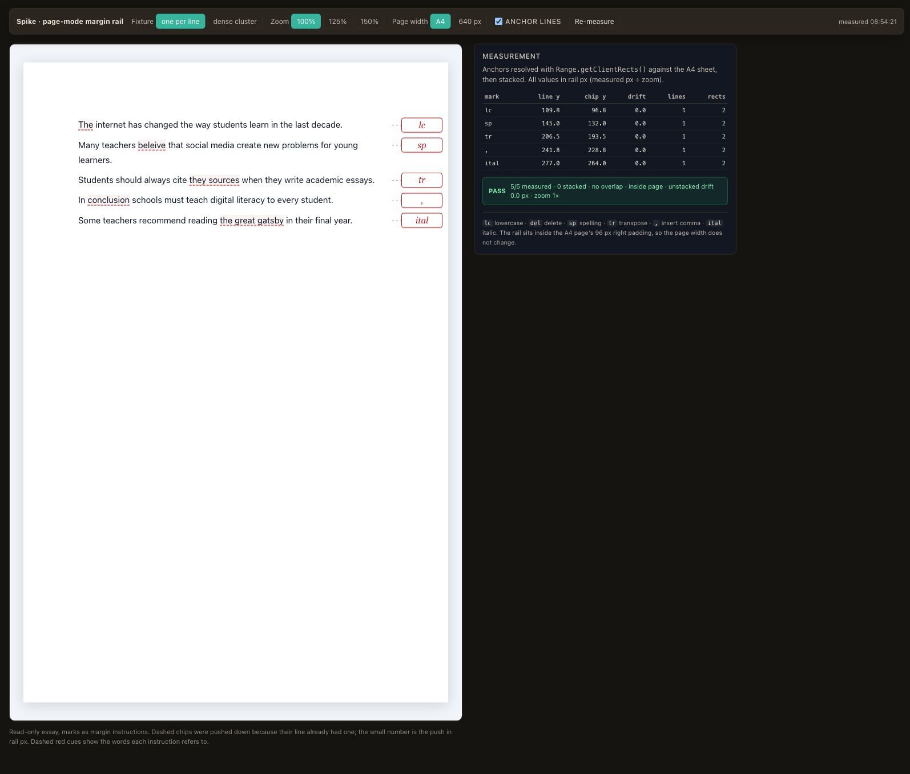

**Dense cluster — stacking with leader lines.** Four marks on one line push chips down; the leader keeps the connection, the number is the push in rail px.

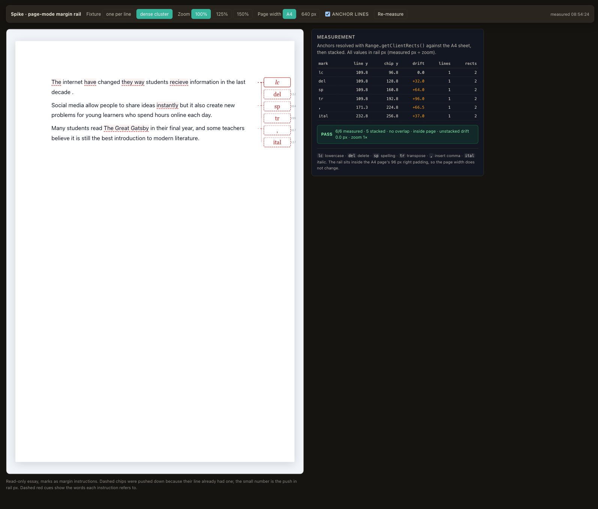

**The failure mode.** 40 marks ungrouped: only the first chip is within a line-height of its target; the rest cascade, and 8 end up past the bottom edge of the sheet. No overlaps — which is why it needs a density rule, not a clamp.

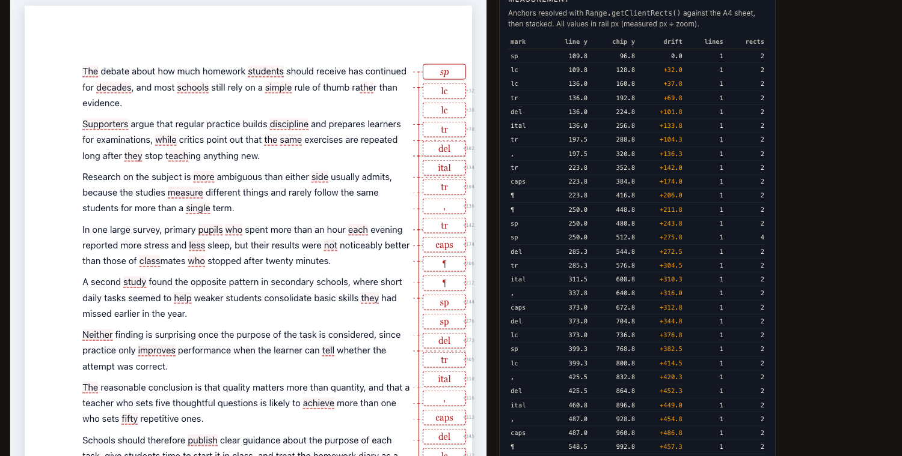

**Grouped rail, 40 marks — fixed.** One chip per line, badge counts the marks on that line, drift 0.0 on all 22 lines.

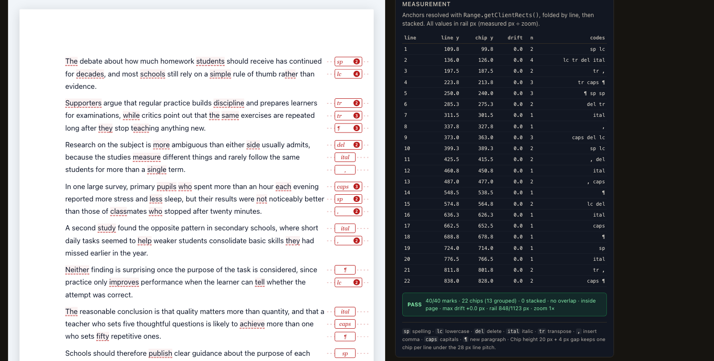

**Badge reveal.** Clicking a badge opens the marks on that line, with code, instruction and the text each refers to.

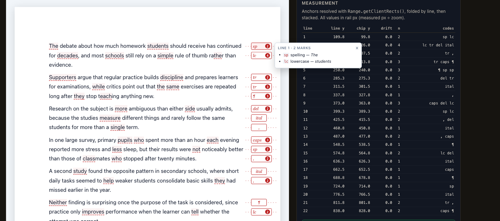

**The whole sheet.** 22 chips, 848 of 1123 px, 275 px of headroom.

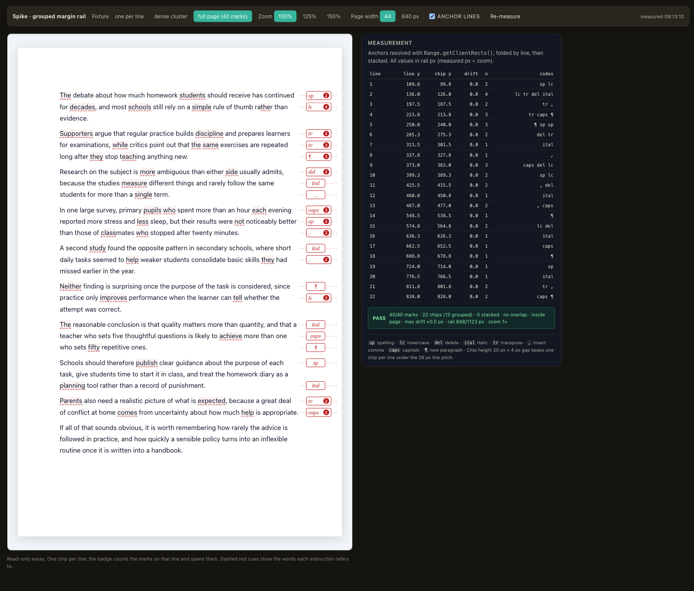

**The cheap version.** The same marks as codes on existing document comments — one attribute, one CSS rule, no new entity.

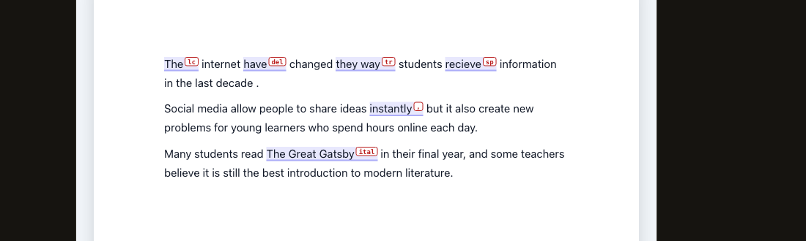

### 2.4 Decisions locked by Phase 0

| Decision                                                                                       | Evidence                                                                                          |
| ---------------------------------------------------------------------------------------------- | ------------------------------------------------------------------------------------------------- |
| Marks are a **sidecar record** rendered as decorations; nothing is written into the essay HTML | Comments already work this way; keeps grading, export and diffing untouched                       |
| Rail is measured against the **A4 page box**, not the text block                               | First attempt against the 176 px text block forced a 5 px overlap; the page (1123 px) passes      |
| **One chip per line**, grouped, with a count badge                                             | 40 marks: 520 px drift → 0.0 px, 8 off-sheet → 0                                                  |
| Chip geometry **20 px + 4 px gap**                                                             | Must stay under the 28 px line pitch; grouping with the old 32 px pitch would still cascade       |
| Rail lives **inside the page's 96 px right padding**                                           | No page-width change, no regression on the student writing surface                                |
| Every symbol carries a **plain-language label** in all 5 locales                               | Decoding is where coded feedback fails (Lee 1997; Zheng & Yu 2018)                                |
| **No handwritten-mark recognition**                                                            | Stamps/palette beat recognition on cost, accuracy and device support (Chromebooks have no stylus) |

### 2.5 Incidental fixes found during Phase 0

- **Page-mode ink (fixed, uncommitted).** `EssayEditor` painted a white A4 sheet but inherited `color` from the theme; the default palette's `--text` is `#f1ebdf`, i.e. near-white on white. The page box now sets `PAGE_INK = '#0f172a'`; compact mode keeps theme colours. Verified by computed style, `npm run typecheck` and the 57-test component smoke suite. **Still uncommitted — see PM-07.**
- **Placeholder/pilcrow contrast (open).** Page mode still uses `var(--text-dim)` for the empty-document placeholder and the show-invisibles pilcrow, which is low-contrast on white.

### 2.6 What Phase 0 did **not** establish

- **Firefox and Safari are unverified.** The sandbox has no root, no apt lists and no GTK/WPE libraries, so Playwright's Firefox and WebKit cannot launch (Chromium's headless shell is also missing 20 system libs). `spike/zoom-gate.mjs` is ready and runs in the repo's Playwright CI container; **PM-15 owns closing this**.
- No keyboard navigation between chips, no focus trap (added only Escape-to-close), no screen-reader pass.
- No print or DOCX/PDF output for marks.
- Grouping tolerance (8 px) is untested against headings and mixed font sizes.
- The 40-mark fixture samples words evenly every ~8 words, so it is a _stress_ distribution, deliberately denser than real marking.

---

## 3. Architecture in one page

```
EssaySubmission.contentHtml ──(read-only EssayEditor)──► ProseMirror doc
                                                          │
                       anchor lookup (needle + occurrence)│
                                                          ▼
DocumentMark[] ──► findTextRange ──► firstLineBox ──► groupByLine ──► stackRail ──► chips
   (sidecar)          (PM positions)   (Range rects)   (one per line)  (no overlap)     │
                                                          │                             ▼
                                        MarkCues decorations (inline dashed cue)   popover / list
```

- **Storage:** a sidecar `document_marks` table + reducer, mirroring `document_comments`. The essay HTML is never modified by a mark.
- **Rendering:** ProseMirror decorations only (view-only), so `RichContent`, `export`, `StudentEssayPage` and DOCX see the essay exactly as submitted.
- **Operations:** a closed vocabulary of eight — `setMark`, `unsetMark`, `deleteRange`, `insertText`, `replaceRange`, `transposeRanges`, `splitBlock`, `setBlockAttr` — with every symbol mapped to one of these or to _advisory_ (no operation). A mark that cannot be derived unambiguously degrades to advisory rather than guessing.
- **Apply:** explicit, per-mark, one ProseMirror transaction each, so undo works and a bad apply is one Ctrl+Z away. No batch apply until PM-12 is proven.

---

## 4. Issue map

Sizes: **S** ≤ 1 day · **M** 2–3 · **L** 4–6 · **XL** 7+.

| ID    | Issue                                          | Milestone | Size | Depends on   |
| ----- | ---------------------------------------------- | --------- | ---- | ------------ |
| PM-01 | Code-on-comment marks (cheap version)          | M1        | S    | —            |
| PM-02 | Mark model, symbol registry and glyph set      | M2        | M    | —            |
| PM-03 | Persistence: reducer, storage, sync, migration | M2        | L    | PM-02        |
| PM-04 | Rail renderer with per-line grouping           | M2        | L    | PM-02, PM-03 |
| PM-05 | Badge reveal + accessible list panel           | M2        | M    | PM-04        |
| PM-06 | Narrow/mobile review sheet + print             | M2        | M    | PM-04        |
| PM-07 | Page-mode ink and contrast follow-ups          | M2        | S    | —            |
| PM-08 | Mark palette + typed code entry                | M3        | M    | PM-04        |
| PM-09 | Edit / move / delete marks + undo              | M3        | M    | PM-04        |
| PM-10 | Density policy beyond one chip per line        | M3        | M    | PM-04        |
| PM-11 | Formatting-family apply (accept/reject)        | M4        | L    | PM-09        |
| PM-12 | Text-operation apply + suggestion state        | M4        | XL   | PM-11        |
| PM-13 | Student view, legend, gloss, analytics         | M5        | L    | PM-05, PM-11 |
| PM-14 | Export marks to DOCX/PDF                       | M5        | M    | PM-04        |
| PM-15 | Cross-engine + a11y + keyboard gate            | M5        | M    | PM-04        |

---

## 5. Issues

### PM-01 · Code-on-comment marks (cheap version)

**Milestone** M1 · **Size** S (≈1 day) · **Depends on** —

**Goal.** Ship a symbol code on the existing document comment so teachers get the mark-at-the-error behaviour this week, with no new entity, table or UI.

**Steps.**

1. In `src/components/Editor/commentDecorations.ts`, add one attribute to the inline decoration: `data-mark-code`, derived from the comment text with a validated parser (`/^\s*([a-z]{1,4}|[,;:¶])(?=[\s—–-]|$)/i`). Do **not** reuse `\b`: it silently drops punctuation codes (this happened in the spike).
2. Add the chip styling to `TIPTAP_CONTENT_STYLES` only if it must appear in `RichContent`; otherwise scope it to the review surface, next to `.comment-highlight` in `tiptapContentStyles.ts`.
3. Add a small helper `codeFromText()` with unit tests (valid code, punctuation code, no code, code in the middle of a sentence, empty comment).
4. Extend the comment composer in `CommentableDocumentView` with a symbol picker that prefixes the code, so teachers do not have to memorise the convention.
5. Add i18n keys for the legend (`proofMarks.legend.*`) to all five locales; the parity test enforces them.
6. Document it in `DocsPage` → Essays tab (what a code is, how to add one, where the legend is).

**Files.** `src/components/Editor/commentDecorations.ts`, `src/components/Editor/tiptapContentStyles.ts`, `src/components/Editor/CommentableDocumentView.tsx`, `src/locales/*.json`, `src/pages/DocsPage.tsx`, `src/utils/proofCode.ts` (new).

**Done when.** A teacher can add a comment, pick `sp` from a small list, and see a chip at the error plus the code in the sidebar; existing comments without codes render unchanged.

**Tests.** `codeFromText` unit tests; decoration test asserting the attribute is present and click handling still fires; axe on the review route.

**Risks.** Free-text codes are unvalidated by nature — a typo renders no chip. Mitigation: picker, plus a "did you mean" hint when the first token is not a known code.

---

### PM-02 · Mark model, symbol registry and glyph set + i18n

**Milestone** M2 · **Size** M (3–4 days) · **Depends on** —

**Goal.** Define what a mark _is_ in data, make the symbol set editable rather than hardcoded to Chicago, and settle what each symbol **looks like** at chip size. The glyph is part of the contract, not decoration deferred to the palette (PM-08): every later surface — rail, popover, legend, export — draws the same shape.

#### What Phase 0 established about the look

The visual work is in `spike/marks-visual.html` (throwaway specimen, screenshots below). Seven things were measured rather than assumed.

1. **The marks are not one kind of object.** Where print draws a mark — delete, caret, close-up, `#`, `¶`, alignments — the glyph is a stroke drawing: one 20-unit grid, 2-unit stroke, round caps, so the stroke is 1.4 px at the 14 px glyph box. Where print writes a letter or a pair — `tr`, `sp`, `¶`, and all five type-style instructions — the glyph is a letterform in the serif italic. The type-style case is forced: in print, caps / lowercase / italic / bold / underline all share the same in-text underline and are disambiguated only by the margin letter, so no shape can carry the difference at 14 px.
2. **The chip is not a tag.** Today's cheapest version (PM-01) paints a 15 px box with a 9 px monospace `sp`; it is legible but reads as a label stuck on the text. The same footprint holding a 14 px glyph reads as a mark, and keeps the PM-01 fallback intact behind it.
3. **Chip geometry is inherited, not re-chosen.** 20 px tall inside the 28 px line pitch, 4 px gap, 72 px rail: the numbers the 40-mark gate already validated. Glyph chips are 28 px wide, letter chips 36 px (two letters need the room), grouped chips 44 px with a 12 px badge.
4. **Ink had to darken to pass the repo's own floor.** The spike's `#b91c1c` is 6.47:1 on paper and fails the 7:1 AAA floor that `contrastPalette.test.ts` enforces. `#991b1b` is 8.31:1 on paper, 7.60:1 on the chip tint and 7.39:1 on the rail; dark mode uses `#fca5a5` (7.93:1 on `#2a261f`). Accepted marks use `#08473e` (10.60:1), rejected `#534d45` (8.35:1) plus a strike — status is never drawn with opacity, because a 50 % chip cannot meet the gate.
5. **A mark needs a second half in the text.** Six cue styles carry the _family_ under the words — strike for delete, strike + dotted for replace, double underline for transpose, dotted for type style, wavy for advisory, a dashed caret for an insertion point — so a reader can tell a deletion from a style note before opening anything. The cue never changes the line style's meaning on its own: the rail glyph is the exact instruction, the cue is the category, and the chip's `aria-label` is the name.
6. **No ghost text inline.** Drawing the suggested word inside the paragraph reflows the essay and moves every anchor below it — exactly the measurement problem Phase 0 was about. The suggestion lives in the popover (and later in the apply flow, PM-12).
7. **RTL is a per-glyph decision.** Mirroring is never a blanket `transform: scaleX(-1)` over the sprite: a mirrored comma is a different mark and a mirrored `sp` is unreadable. Only the two glyphs whose shape encodes reading order — `del` and close-up — declare `mirror: 'rtl'` and are drawn as `scale(-1 1) translate(-20 0)` on the paths alone, so the delete tail points back toward the line start. Letterforms, punctuation and `tr`/`sp`/`¶` never mirror. The alignment marks do not mirror either: `align-left` is a physical instruction (`text-align: left`), the same value the app already stores, so icon and applied value agree in both scripts. Everything around the glyph is logical instead: chips use `inset-inline-start` and `margin-inline-end`, the rail sits on the inline-end side of the page, and the badge follows `dir` — no `left: 0` anywhere (PM-04 enforces it in the renderer).

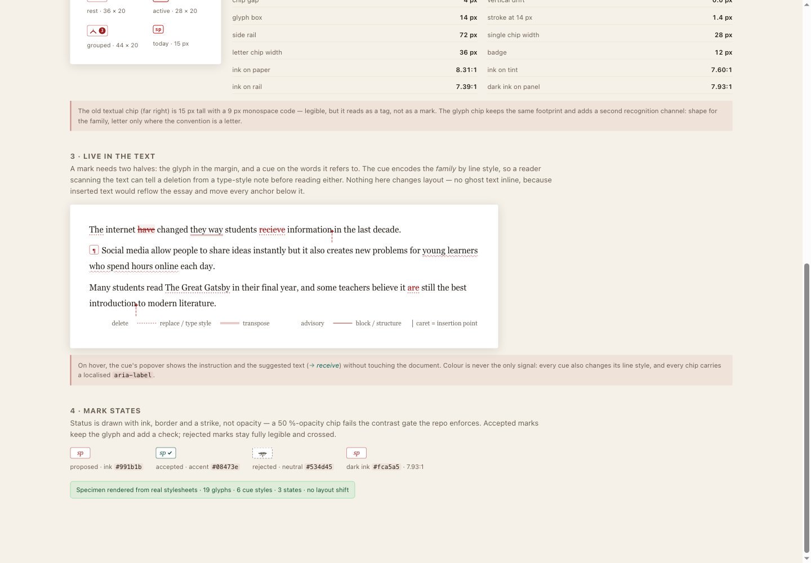

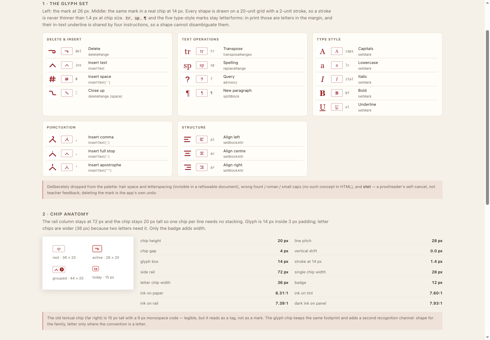

**The 19 seed symbols.** `del` delete (deleteRange) · `ins` insert text (insertText) · `#` insert space (insertText) · `⁐` close up (deleteRange on the space) · `¶` new paragraph (splitBlock) · `tr` transpose (transposeRanges) · `sp` spelling (replaceRange) · `?` query (advisory) · `caps` / `lc` / `ital` / `bf` / `ul` (setMark) · `,` `.` `'` insert punctuation (insertText) · align left / centre / right (setBlockAttr).

Dropped on purpose, to be recorded in the registry: hair space, letterspacing and equalise-space (invisible in a reflowable document), wrong fount / roman / small caps (no HTML equivalent), and **stet** — a proofreader's self-cancel, not teacher feedback; rejecting a mark is the app's own undo.

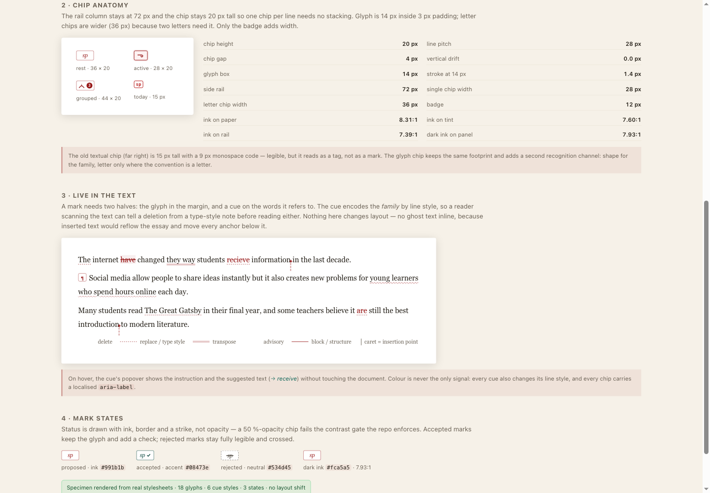

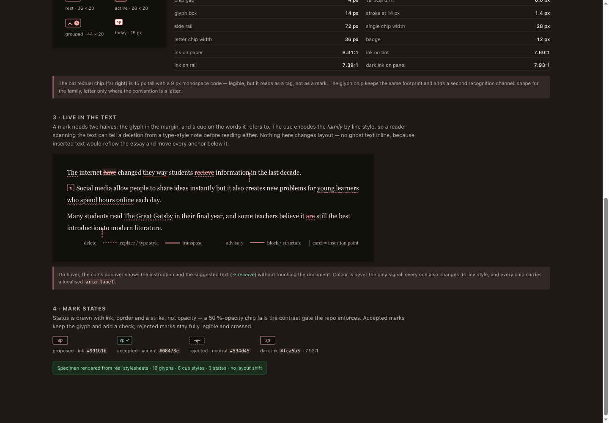

#### Steps

1. Add to `src/types/index.ts`: `DocumentMark` (`id`, `attachmentId`/`essayId`, `authorId`, `symbolId`, `anchor {from,to}`, `extraAnchor?`, `payload?`, `status: 'noted' | 'proposed' | 'accepted' | 'rejected'`, `note?`, `snippetHash?`, timestamps) and `MarkOperation`.
2. Create `src/data/proofMarks.ts` with the registry: one entry per symbol — `{ id, glyph: MarkGlyphId, family, operation | null, labelKey }`. Seed with the 19 symbols above; record the dropped CMOS/ISO marks and the reason in a comment.
3. Create `src/data/markGlyphs.ts`: the path table (`d` strings on the 20×20 grid) plus the letterform tier, so a glyph is data and the registry stays free of JSX. Two kinds, one type: `{ kind: 'stroke', paths: string[]; mirror?: 'rtl' } | { kind: 'letter'; text: string; letterStyle?: 'italic' | 'bold' | 'underline' }`, plus `getMarkGlyph(id)` (an unknown id falls back to the query mark) and `isMirroredInRtl(glyph)`.
4. Add `src/components/Editor/MarkGlyph.tsx`: one component (`id`, `dir`, `size`, `className`) that renders an inline SVG for stroke glyphs (`viewBox 0 0 20 20`, `currentColor`, `stroke-width: 2`, round caps) and a serif letterform for the letter tier, always `aria-hidden`. It mirrors per glyph — `scale(-1 1) translate(-20 0)` on the paths of `del` and close-up when `dir="rtl"` — and never mirrors the sprite. No icon font and no new dependency — an icon font cannot inherit `currentColor`, needs a webfont round-trip before first paint, and gives no per-glyph tree-shaking.
5. Add `proofMarks.<id>.label` keys to `en/nl/fr/de/es`, plus family names. Keep labels _instructions_ ("set in lowercase"), not glyph names: the glyph is the recognition aid, the label is the meaning.
6. Export helpers: `getSymbol(id)`, `getGlyph(id)`, `operationFor(symbolId)`, `symbolsByFamily()`.
7. Unit tests: unique ids; every entry has a label in every locale; operation mapping is total (either an operation or explicitly advisory); every registry id resolves to a glyph of a known kind; every path string parses as a path; mirroring is exactly `del` + close-up and never a letterform; unknown id falls back to an advisory mark rather than throwing.
8. Extend the palette contrast test with the four mark inks (`#991b1b`, `#fca5a5`, `#08473e`, `#534d45`) so the chip ink can never regress below 7:1 in either theme.

**Files.** `src/types/index.ts`, `src/data/proofMarks.ts` (new), `src/data/markGlyphs.ts` (new), `src/components/Editor/MarkGlyph.tsx` (new), `src/locales/*.json`, `src/utils/contrastPalette.test.ts` (fixtures), `src/utils/proofMarks.test.ts`.

**Done when.** `symbolsByFamily()` returns the palette contents with a glyph for every entry, the specimen page renders all 19 at 26 / 16 / 14 px without misreading, and adding a symbol requires touching one data file plus five locale files — never a component.

**Tests.** Registry integrity test; glyph-table test (id ↔ path, path parses, letterform tier covered); i18n parity extension; operation-vocabulary test; palette contrast extension.

**Risks.** At 14 px, `del` and `⁐` are the two glyphs that rely most on the popover: the loop and the hooks compress into a single stroke. Mitigation: the label and popover carry the meaning, the palette preview (PM-08) runs at 20 px, and PM-08 adds a five-teacher recognition check with the letterform as the fallback. Over-porting print-only marks (`wf`, hair space, letterspace) stays out for the same reason as before: the registry starts small.

---

### PM-03 · Persistence: reducer, storage, sync, migration

**Milestone** M2 · **Size** L (4–6 days) · **Depends on** PM-02

**Goal.** Marks survive reload, sync across devices, and are erased with the student, exactly like comments.

**Steps.**

1. Migration `supabase/migrations/111_document_marks.sql` (next free number after `110_admin_school_scope_write.sql`), modelled on `062_document_comments.sql`: table, RLS policies, indexes on `(attachment_id)` and `(owner_id)`, timestamps. Follow the numbering rule in `supabase/CLAUDE.md`.
2. Add the table to `079_owner_data_registry.sql` expectations and to the `erase_student` function; extend `src/__tests__/studentDataRegistry.test.ts` fixtures so the guard fails if marks are missed.
3. Adapter in `src/services/database/` + mapping in `StorageSync.pushOne` and the pending-sync queue in `storage.ts`.
4. Reducer actions in `AppContext`: `ADD_DOCUMENT_MARK`, `UPDATE_DOCUMENT_MARK`, `DELETE_DOCUMENT_MARK`, `SET_DOCUMENT_MARK_STATUS`; gate the `localStorage` write through `isOffline()` as the storage rule requires.
5. `storage.ts`: load/save, `importFullBackup`/`exportFullBackup`, and snapshot-cache handling for larger collections.
6. Conflict handling reuses `syncMerge.ts` (last-write-wins by `updatedAt`); do not hand-roll merge logic.

**Files.** `supabase/migrations/*`, `supabase/functions/*` (erase path), `src/services/database/*`, `src/store/storage.ts`, `src/context/AppContext.tsx`, `src/types/index.ts`, `src/__tests__/studentDataRegistry.test.ts`.

**Done when.** Create a mark offline → reconnect → it syncs; erase a student → their marks are gone from device and cloud; a backup round-trips.

**Tests.** Reducer unit tests; storage round-trip; pending-queue retry; merge last-write-wins; erase-student includes marks; registry guard test.

**Risks.** Forgetting the erase path is a privacy bug. Mitigation: the registry test is the gate — add the fixture before the feature.

---

### PM-04 · Rail renderer with per-line grouping

**Milestone** M2 · **Size** L (4–6 days) · **Depends on** PM-02, PM-03

**Goal.** Production version of the spike: measure anchors against the page box, group by line, render chips with leader lines, inside the review surface.

**Steps.**

1. Move the pure helpers from `spike/positioning.ts` into `src/utils/proofRail.ts`, unchanged in behaviour, with the spike's checks converted into Vitest tests (spread, single-line cluster, near-collision, ordering, clamps, 40 marks / 20 lines).
2. Add `useProofRail({ editor, pageElement, marks, chipHeight: 20, gap: 4 })` → `rows` plus a `remeasure()` callback. Recompute on `ResizeObserver` (content and page), `window.resize`, `document.fonts.ready`, and after any mark mutation.
3. Handle the two coordinate cases: plain layout (measured px are layout px) and CSS `zoom`/transform (divide by the factor). Document the distinction in the hook, because missing it is a 25–33 % drift.
4. Render `<ProofRail>`: chips are `<button>`s with `aria-label` ("3 marks on line 9: caps, del, lc") and `aria-expanded`; leader line and anchor tick for stacked chips (should be rare once grouping is on); grouped badge.
5. Mark anchoring: `findTextRange` with occurrence support; store `snippetHash` on creation and re-anchor by search when the hash mismatches; drop out-of-bounds anchors the way `commentDecorationSpecs` does.
6. Mount behind a flag in `CommentableDocumentView`. **Decide page mode:** today it passes `allowPageMode={false}`, which makes page mode unreachable, so the rail has no A4 sheet to attach to — either add a review-specific page mode or the rail renders in the compact view with a 96 px padding column.
7. Multi-line ranges: anchor to the first line and mark the chip (e.g. a `↳` glyph) rather than guessing.

**Files.** `src/utils/proofRail.ts` (new) + test, `src/components/Editor/ProofRail.tsx` (new), `src/components/Editor/useProofRail.ts` (new), `src/components/Editor/CommentableDocumentView.tsx`, `src/components/Editor/markCues.ts` (promoted from the spike), `src/pages/DocsPage.tsx`.

**Done when.** The spike's 40-mark fixture renders inside the app with 0.0 px drift and no chips off the page; the diagnostics panel is gone; the rail updates when the window resizes.

**Tests.** Pure geometry tests (ported); component tests with a stubbed editor; one e2e screenshot at 3 viewports; anchor-drift test with a mutated document.

**Risks.** `ResizeObserver` loops (measuring on a change that measurement causes). Mitigation: never write layout-affecting styles from the measurement pass; only absolutely positioned chips.

---

### PM-05 · Badge reveal + accessible list panel

**Milestone** M2 · **Size** M (2–3 days) · **Depends on** PM-04

**Goal.** Make grouped marks usable and accessible: the badge opens the marks on its line, by mouse and keyboard.

**Steps.**

1. Popover component with placement logic: prefer right of the chip, flip left when there is no room, overlay as a sheet under ~640 px, and clamp vertically inside the page.
2. Keyboard model: roving tabindex across chips, `ArrowUp`/`ArrowDown` to move, `Enter`/`Space` to open, `Esc` to close and return focus to the chip, focus trapped while open. (Phase 0 only has Escape.)
3. Announce the group: `role="dialog"` + `aria-labelledby` on the header, list semantics inside, and a live-region summary when the rail re-measures.
4. Show the _instruction_, not just the code: `sp — spelling — recieve → receive`, in the active locale.
5. Empty and single states: a one-mark chip has no badge but is still clickable.
6. Test keyboard-only flow in Playwright; `jest-axe` on the rail with the popover open.

**Files.** `src/components/Editor/ProofMarkPopover.tsx` (new), `proofRail` hook, tests, `e2e/specs/` (new spec).

**Done when.** A keyboard-only user can reach every mark, open it, read it, and close it without a mouse; the axe gate passes with the popover open.

**Tests.** Focus-order test; flip/clamp unit tests on the placement function; e2e keyboard spec.

**Risks.** The popover has nowhere to open in the compact view. Mitigation: the overlay-sheet fallback, which PM-06 also needs.

---

### PM-06 · Narrow/mobile review sheet + print

**Milestone** M2 · **Size** M (2–3 days) · **Depends on** PM-04

**Goal.** Keep marked feedback usable when the rail cannot fit, and make a marked essay printable.

**Steps.**

1. `ProofMarkList`: same mark data rendered per paragraph below the text ("¶2 · sp _recieve_ → _receive_"). Trigger it when the container is narrower than ~900 px or the page is not in page mode.
2. Visibility rules so the list is not a wall of marks: group by paragraph, collapse to a count, "show all" toggle.
3. Print stylesheet: superscript chips inline plus the list after each paragraph; no absolute positioning in print. Add a `@media print` block and verify with a PDF print.
4. Optional: `@page` margin column for browsers that support margin boxes — behind a flag, off by default.
5. Snapshot tests for both renderers from one data set.

**Files.** `src/components/Editor/ProofMarkList.tsx` (new), `src/components/Editor/ProofRail.tsx`, styles, tests.

**Done when.** At 640 px the marks are readable without horizontal scrolling, and a printed page shows the cue and the instruction.

**Tests.** Renderer-selection test; print snapshot; e2e at 640 px.

**Risks.** Two renderers drifting apart. Mitigation: both consume the same `rows`; only presentation differs.

---

### PM-07 · Page-mode ink and contrast follow-ups

**Milestone** M2 · **Size** S (½ day) · **Depends on** —

**Goal.** Finish the theme fix found in Phase 0 and add a regression guard.

**Steps.**

1. **Already done (uncommitted):** `PAGE_INK = '#0f172a'` on the A4 page box in `EssayEditor`. Commit it.
2. Replace `var(--text-dim)` in `.show-invisibles` and `.is-empty::before` with a page-scoped token so both are legible on white in every theme.
3. Add a colour token for mark ink on the sheet (target ≥ 7:1 against `#fff`, matching the project's AAA floor) and use it for cues, chips and the popover accent.
4. Regression test: computed `color` of `.essay-editor-content` is the page ink in both themes; add page mode to `src/utils/contrastPalette.test.ts` coverage.
5. Add the review route to `A11Y_ROUTES` once it exists as a route.

**Files.** `src/components/Editor/EssayEditor.tsx`, `src/components/Editor/tiptapContentStyles.ts`, `src/index.css`, `src/utils/contrastPalette.test.ts`, `e2e/fixtures/a11y.fixture.ts`.

**Done when.** Page mode is legible in light and dark themes, and a test fails if the page ink starts inheriting the theme again.

**Tests.** Contrast unit test; e2e axe route.

---

### PM-08 · Mark palette + typed code entry

**Milestone** M3 · **Size** M (2–3 days) · **Depends on** PM-04

**Goal.** Fast, discoverable placement: select text, choose a symbol; or type the code.

**Steps.**

1. Palette grouped by family (type-style, punctuation, structure, text operations, advisory), with the glyph, the localised label and a keyboard shortcut per family.
2. Typed entry: a small field (or a keyboard chord) where `sp`, `ital`, `lc` resolve against the registry with fuzzy matching and Enter applies to the current selection.
3. Create-mark command: validates a non-empty selection, derives the operation, writes the record, focuses the new chip.
4. Disable with a clear hint when the selection is empty or the surface is the student writing view.
5. Accessibility: every palette button named; the palette is reachable and operable by keyboard; shortcuts documented in the tooltip.

**Files.** `src/components/Editor/ProofMarkPalette.tsx` (new), bubble menu in `CommentableDocumentView.tsx`, `src/data/proofMarks.ts` (shortcuts), locales.

**Done when.** A teacher can mark a sentence with three different symbols without touching the mouse for placement.

**Tests.** Palette keyboard test; code resolution tests (including near-misses); command test.

---

### PM-09 · Edit, move, delete marks, and undo

**Milestone** M3 · **Size** M (2–3 days) · **Depends on** PM-04

**Goal.** Marks behave like first-class objects: fixable, removable, recoverable.

**Steps.**

1. Per-mark actions in the popover: change symbol, edit replacement text, add a note, delete.
2. Undo: marks live in app state, not ProseMirror history, so add an explicit undo stack for mark mutations (or snapshot-on-change with a bounded history). Document the decision — mixed undo models are a trap.
3. Anchor validation on load: bounds + `snippetHash`; marks that no longer match are flagged `unanchored` and listed rather than silently misplaced.
4. Deletion is immediate in the UI with an undo toast; no confirmation dialog.
5. Tests: reducer + undo/redo, drift detection, deletion of a mark whose range vanished.

**Files.** `src/components/Editor/ProofMarkPopover.tsx`, `src/context/AppContext.tsx`, `src/utils/markUndo.ts` (new, if the stack approach wins), tests.

**Done when.** Every mark mutation is reversible, and a stale anchor never shows on the wrong text.

**Tests.** Undo/redo unit tests; anchor-drift unit test; e2e edit-and-undo.

**Risks.** Two undo systems confusing users (Ctrl+Z in the editor vs marks). Mitigation: mark undo is scoped to the rail and surfaced as a toast, not bound to Ctrl+Z globally.

---

### PM-10 · Density policy beyond one chip per line

**Milestone** M3 · **Size** M (2–3 days) · **Depends on** PM-04

**Goal.** Define what happens when the page runs out of _lines_, not just marks.

**Steps.**

1. Establish the thresholds from Phase 0: one chip per line holds ~33–40 chips on A4 at 28 px pitch; grouping makes mark count irrelevant. The real limits are (a) more chips than lines and (b) multiple pages.
2. Two-column rail behind a measurement check: requires ~150 px, i.e. the page's whole right padding — measure first, never assume.
3. Multi-page: the page box grows with content (`minHeight: 1123`), so verify the rail re-anchors per page and does not assume a single sheet; if print pagination is added later, split marks per page.
4. Stress fixture: the spike's 200-mark variant to prove the rail still cannot exceed the line count.
5. Document the rule in the epic and in code comments where the thresholds live.

**Files.** `src/components/Editor/ProofRail.tsx`, `src/utils/proofRail.ts`, `spike/article.ts` (stress fixture), tests.

**Done when.** A pathological essay (marks on every line for 3 pages) renders without drift, overlap or off-page chips.

**Tests.** 200-mark stress test; multi-page measurement test.

---

### PM-11 · Formatting-family apply (accept / reject)

**Milestone** M4 · **Size** L (4–6 days) · **Depends on** PM-09

**Goal.** The cheapest half of "correct the essay": apply type-style marks, reversibly.

**Steps.**

1. Operation runner: `setMark` / `unsetMark` on a range using `tr.addMark` / `tr.removeMark`; map `ital`, `rom`, `bf`, `caps`, `lc`, `sc` onto existing marks or `text-transform` styles that already exist in the editor.
2. Status machine per mark: `noted → proposed → accepted | rejected`, persisted (PM-03 schema already carries `status`).
3. Accept/reject UI in the popover, plus "accept all formatting on this page" as the _only_ batch action.
4. One transaction per apply, so the editor's own undo covers it; verify redo.
5. Conflict guard: if the anchor no longer matches the stored snippet, refuse and explain.
6. Tests: apply/undo/redo for each symbol; idempotent re-apply; applying to a selection spanning marks.

**Files.** `src/utils/markOperations.ts` (new), `ProofMarkPopover.tsx`, `AppContext` reducer, tests.

**Done when.** `ital` on a phrase, accept, undo, redo all behave exactly like manual formatting.

**Tests.** Operation unit tests with a real editor instance (the `commentDecorations.test.ts` pattern); e2e accept/undo.

**Risks.** Marks interacting with existing formatting (`excludes`). Mitigation: reuse the editor's own commands rather than constructing marks manually.

---

### PM-12 · Text-operation apply + suggestion state

**Milestone** M4 · **Size** XL (7–10 days) · **Depends on** PM-11

**Goal.** The other half: delete, replace, insert, transpose — with the ambiguity handled explicitly.

**Steps.**

1. Operations: `deleteRange`, `replaceRange`, `insertText` (punctuation, spaces), `transposeRanges`, `splitBlock` (`¶`), `setBlockAttr` (indent/align).
2. Encode derivation rules per symbol in `src/data/proofMarks.ts` (e.g. `delete` → delete the selection **and** the adjacent space; `tr` → split the range at the word boundary by whitespace; `sp` → advisory only).
3. Derive-or-degrade: when a rule cannot be applied unambiguously (range across blocks, `tr` on a single token, `close up` with no adjacent space), the mark is created as advisory with a note. Never guess silently.
4. Suggestion state + per-mark apply, reusing PM-11's machine; no batch apply.
5. Property tests with `fast-check`: random documents and ranges, invariants — no text loss outside the operation, undo restores the exact original JSON, apply is idempotent.
6. E2E: apply a realistic set of corrections to an essay, then undo all and assert the original HTML.

**Files.** `src/utils/markOperations.ts`, `src/data/proofMarks.ts`, popover, tests.

**Done when.** The eight operations are covered by property tests, and every ambiguous case is provably advisory rather than a silent edit.

**Tests.** Property tests; operation table tests; e2e apply/undo round-trip.

**Risks.** Highest-risk issue in the epic (data loss). Mitigation: explicit per-mark apply only, one transaction each, undo verified, no auto-apply ever.

---

### PM-13 · Student view, legend, gloss, analytics

**Milestone** M5 · **Size** L (4–6 days) · **Depends on** PM-05, PM-11

**Goal.** The reason the feature exists: the student can decode the marks, in their own language, and the teacher can see what recurs.

**Steps.**

1. Student-facing mark view (read-only) on the submitted essay: inline cue + chip + tap-to-read gloss; no teacher-only notes.
2. Legend: every symbol used in this essay, with its localised label and one-line explanation; link it from the essay page.
3. Per-mark student actions once PM-11 lands: accept/dismiss formatting corrections ("show corrected" toggle), never destructive text edits.
4. Analytics: counts by symbol per student and per class, plus "corrections accepted" — reuse the existing aggregation patterns; no AI, deterministic counts only.
5. Update `DocsPage` Essays tab, `README` routes table if a route is added, and the `LandingPage` student/teacher cards, per the documentation-maintenance rule.

**Files.** student essay route/component, `src/utils/markAggregation.ts` (new), locales, docs pages.

**Done when.** A student can open their marked essay, understand every symbol without asking, and see which corrections they accepted.

**Tests.** Aggregation unit tests; student-view render test; i18n parity; axe.

**Risks.** Marks leaking teacher-only notes to students. Mitigation: RLS + an explicit field-level filter on the student projection.

---

### PM-14 · Export marks to DOCX/PDF

**Milestone** M5 · **Size** M (2–3 days) · **Depends on** PM-04

**Goal.** A marked essay can leave the app.

**Steps.**

1. Inline marks first: in `src/utils/essayExport.ts`, render the cue (strike for delete, underline for insert, superscript chips) as runs inside the existing `Paragraph`s — no layout change, template-compatible.
2. Margin column behind a flag: two-column table (text | marks) only when the style template allows it; measure against a real export before enabling.
3. PDF: reuse the same HTML → PDF path; visual check of one marked essay.
4. Keep export deterministic: no absolute positioning, no rail geometry in the file.
5. Test: exported DOCX contains the codes and the per-paragraph list; round-trip check with the existing docx tests.

**Files.** `src/utils/essayExport.ts`, `src/utils/pdfExport.ts`, tests, `src/pages/DocsPage.tsx`.

**Done when.** A marked essay exports with readable cues and instructions, and the existing template tests still pass.

---

### PM-15 · Cross-engine, a11y and keyboard gate

**Milestone** M5 · **Size** M (2–3 days) · **Depends on** PM-04

**Goal.** Close the gaps Phase 0 could not: Firefox, WebKit, keyboard-only, and the axe gate.

**Steps.**

1. Turn `spike/zoom-gate.mjs` into a CI job or Playwright spec that runs in the repo's Playwright container (which ships chromium, firefox and webkit): 3 engines × 3 viewport-zoom levels × the 3 fixtures, asserting drift, overlaps, off-page chips and the badge reveal.
2. Register the review route in `A11Y_ROUTES` (`e2e/fixtures/a11y.fixture.ts`) and the baseline; fix any new violations rather than baselining them.
3. Keyboard-only pass over placement, navigation and apply; document whatever remains (e.g. screen-reader announcements across browsers were not manually verified).
4. Add a contrast assertion for mark ink on white and on the highlight tint.
5. Record the Firefox/Safari results in this epic, replacing "unverified".

**Files.** `spike/zoom-gate.mjs` → `e2e/specs/` (or a workflow), `e2e/fixtures/a11y.fixture.ts`, `e2e/a11y-baseline.json`, `src/utils/contrastPalette.test.ts`.

**Done when.** All three engines pass the gate in CI, and the review route is in the axe route list with zero new violations.

---

## 6. Milestones

| Milestone | Contents     | Estimate    | Outcome                                                             |
| --------- | ------------ | ----------- | ------------------------------------------------------------------- |
| **M1**    | PM-01        | ~1 day      | Codes on comments in teachers' hands; appetite signal               |
| **M2**    | PM-02…PM-07  | ~18–22 days | Read-only rail with grouped chips, accessible, persisted, printable |
| **M3**    | PM-08…PM-10  | ~7–9 days   | Fast placement, editable marks, density policy                      |
| **M4**    | PM-11, PM-12 | ~12–16 days | Marks that can correct the essay                                    |
| **M5**    | PM-13…PM-15  | ~9–12 days  | Student gloss/analytics, export, cross-engine + a11y                |

M1 and M2 can run in parallel after PM-02. **M4 should not start before a teacher trial of M2** — the value question ("do they want the app to _apply_ the correction, or just explain it?") is not settled by the research.

---

## 7. Cross-cutting requirements

- **i18n:** every user-visible string in `en/nl/fr/de/es`; `usedKeys.test.ts` and the locale-parity test enforce it. Symbol labels are instructions, not glyph names.
- **Accessibility:** the axe gate (WCAG 2.0/2.1/2.2 A+AA+AAA, serious/critical only, zero contrast debt) applies to any new route; the sidebar/list is the canonical accessible representation of marks, the rail is a visual shortcut.
- **Storage rule:** `storage.ts` is the single write point; `localStorage` writes only when `isOffline()`; pending-queue retries on reconnect.
- **No AI generation:** deterministic checks only. Auto-marking is out of scope (AGENTS.md).
- **RTL:** the rail mirrors; caret glyphs must flip; never hardcode `right: 0`.
- **Documentation maintenance:** every user-facing change updates `DocsPage`, `README` and the `LandingPage` cards in the same task.
- **Types:** all domain types in `src/types/index.ts`; no inline shapes for persisted data.
- **Tests:** new logic needs unit tests; new routes need an axe entry; quarantine rules apply to flaky specs.

---

## 8. Risks

| #   | Risk                                      | Where        | Mitigation                                                                 |
| --- | ----------------------------------------- | ------------ | -------------------------------------------------------------------------- |
| 1   | Ambiguous apply mangles text              | PM-12        | Closed vocabulary, derive-or-degrade, per-mark apply, undo, property tests |
| 2   | Anchor drift on edited essays             | PM-04, PM-09 | `snippetHash` + re-anchor by search; flag `unanchored`                     |
| 3   | Grouping hides per-mark instructions      | PM-05        | Badge + popover; inline cues on every mark; legend                         |
| 4   | Grouping tolerance under headings         | PM-04, PM-10 | Test mixed font sizes; tolerance is a hook option                          |
| 5   | Print/export fidelity                     | PM-06, PM-14 | Inline first, margin column behind a flag                                  |
| 6   | Firefox/Safari differences                | PM-15        | CI gate in the Playwright container                                        |
| 7   | Erase/backup misses marks                 | PM-03        | Registry guard test written first                                          |
| 8   | Two undo models confuse teachers          | PM-09        | Mark undo scoped to the rail, surfaced as a toast                          |
| 9   | Density > capacity on pathological essays | PM-10        | Rail bounded by line count; two-column only if measured                    |

---

## 9. Decisions needed before M2

1. **Who marks whom?** Teacher-only review, or student-applied corrections too? (PM-11+ only matter in the second case.)
2. **Page mode on the review surface.** `CommentableDocumentView` currently passes `allowPageMode={false}`, so the A4 sheet — and therefore the rail — is unreachable there. Add a review page mode, or accept the compact view with its own padding column?
3. **Print requirement?** If marked essays must print with a margin column, that is settled before PM-06 rather than after.
4. **Symbol set.** Chicago (the sheet), ISO 5776, or the school's own codes? Recommendation: data-defined, Chicago-seeded.
5. **Target devices.** Any stylus hardware? A "no" closes the ink question permanently.

---

## 10. Out of scope

- Handwritten ink with mark _recognition_ (stamps/palette instead; ink only as decoration if ever).
- OCR of a scanned paper proof (the ProofRite problem — separate product).
- Auto-marking by any means, including rule-based checks, in this epic.
- Multiple teachers marking the same essay concurrently (the data model tolerates it; the UX does not).
- Marks inside code blocks or tables (explicitly deferred; the comment extension has the same limitation and a documented workaround).

---

## 11. Appendix

**Measurement definitions.** _Line_ = first `DOMRect` of the anchor range, centre = `top + height/2`; _drift_ = chip centre minus its line centre, in rail px; _rail px_ = measured px ÷ CSS zoom factor; _span_ = distinct `top` values across the range's rects (not `rects.length`, which returns 2 for a single-word range at element boundaries).

**Re-running the Phase 0 gates.**

```bash
npm ci
npm run dev -- --host 0.0.0.0            # /spike/proofmarks.html and /spike/comment-code.html
node spike/positioning.check.ts          # stacking algorithm
npx playwright install --with-deps firefox webkit
node spike/zoom-gate.mjs                 # 3 engines × 3 zoom levels × 3 fixtures
```

**Spike disposition.** `spike/` stays in the repo as the evidence harness and gate tool for PM-15. It is excluded from `tsconfig`, contains no `.test.ts` files, and is not imported by the app; delete it once PM-15 owns the gate, and move any screenshot the docs still reference into `docs/img/`.
